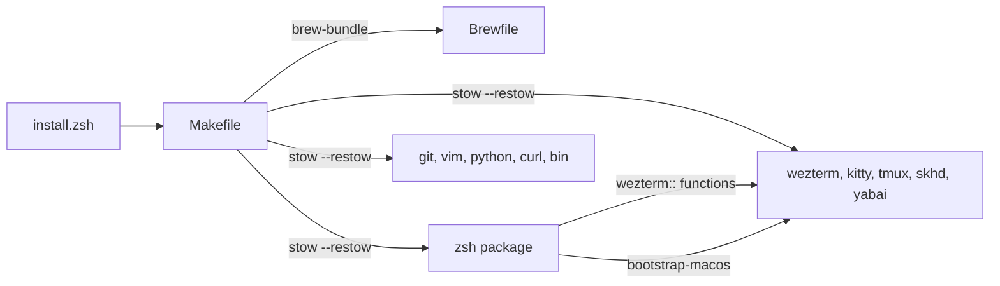

## Using these docs

| What you know | Start here |
|---|---|
| Nothing about the repository | Continue with this page. |
| You are about to change code | Read [reference/style.md](reference/style.md), then use the task or path route. |
| The task you need to perform | Search Markdown across this docs tree with a few context lines; [COMMON-TASKS.md](COMMON-TASKS.md) provides task shortcuts. |
| A repository file or directory | Search its repo-relative path in [INDEX.md](INDEX.md). |

The tree descends from this page into `areas/`, then into `components/` where needed.
`flows/` explain recurring changes across areas. `reference/` holds code style, terms,
stack details, and gotchas. Parent and child links move through detail; **Related** links move
between connected subjects. Component docs end with the source files to open.

## Working efficiently

- **Route with targeted search.** Search Markdown across the docs tree with `rg -n -i -C 2 -g '*.md'`
  and task keywords, then open the relevant section. Try related terms if matches are sparse;
  narrow the pattern or directory if output is large. Never read `INDEX.md` or `COMMON-TASKS.md` in full.
  For a known file or directory, search its exact repo-relative path in `INDEX.md`.
- **Verify from anchors first.** Treat cited source-file `path:line` anchors as the default verification path.
  Do not rescan an entire module unless an anchor is stale, missing, or
  contradicts the task or working tree.
- **Ask route-changing questions early.** Ask route-changing questions before reading detailed docs or source.
  Combine related unresolved decisions into one question where possible.
- **Use Java LSP when available.** When `jdtls` is available, use it for semantic Java navigation and diagnostics
  before inferring definitions or references from text search.
- **Use Markdown for plans.** Return implementation plans as Markdown by default. Do not create
  an HTML or designed artifact unless the user explicitly requests one.

## What this repository is

The repository is a set of GNU Stow packages. Each top-level directory mirrors `$HOME`, and `make install` runs `stow --restow` on each directory alone, so a conflict skips only that package (`Makefile:40-41`). Most of the content is shell: the `zsh` package holds about 146 of the 204 documented files, 67 of them autoloaded functions that each pair with a completion file. The rest is Lua (WezTerm), Make, Python, Vim script, Dockerfiles and a Ruby `Brewfile`, plus plain configuration for terminals, git and CLI programs.

Languages by location:

| Language | Where |
|---|---|
| zsh | `zsh/`, `install.zsh`, `.github/tests/*.zsh`, `bin/.local/bin/*.zsh` |
| Lua | `wezterm/.config/wezterm/` |
| Make | `Makefile`, `docker/Makefile`, `bin/.local/bin/Makefile` |
| Python | `python/.config/python/init-repl.py`, `.github/tests/terminal.py` |
| Vim script | `vim/.vimrc` |
| Dockerfile | `Dockerfile`, `arch-linux.Dockerfile` |
| Ruby DSL | `Brewfile` |
| Config formats | kitty, skhd, yabai, tmux, git, curl, htop, ripgrep, topgrade |

## How the system works

Installation starts at `install.zsh`, which `curl` can run on a machine with nothing installed. It checks the environment, clones the repository to `~/.config/dotfiles`, and hands every later step to a `Makefile` target, so the one-liner and a manual `make` run behave the same (`install.zsh:13-15`). The targets install Homebrew, sync the `Brewfile` with `--force-cleanup --zap`, which removes packages the file does not list, and stow each package. [Bootstrap](areas/bootstrap.md) covers the flags, the stages, the Docker images and the CI checks.

After stowing, the shell is the main runtime. `zsh/.zshenv` sets `ZDOTDIR`, `.zprofile` puts `functions/` and `completions/` on `fpath` and autoloads every function, and `.zshrc` sources the numbered rc.d files in order, then runs `compinit` (`zsh/.zshenv:6`, `zsh/.config/zsh/.zshrc:23-30`). Setting `NO_RC` skips the rc.d loop. [Zsh](areas/zsh.md) explains the order and links to five component docs.

The other packages are read by their own programs. [Desktop](areas/desktop.md) covers WezTerm, kitty, tmux, skhd, yabai and the Terminal.app profile. [CLI tools](areas/cli-tools.md) covers git, vim, python, curl, ripgrep and the scripts in `bin/.local/bin`. The `wezterm::` shell functions and the WezTerm Lua config each implement a pane move, which ties zsh to desktop.

## Areas

- **[Zsh](areas/zsh.md)** — startup files, rc.d stages, zinit plugins and the autoloaded function library. Five components: [startup](components/zsh/startup.md), [function tooling](components/zsh/function-tooling.md), [everyday utilities](components/zsh/everyday-utilities.md), [system maintenance](components/zsh/system-maintenance.md) and [dev and terminal](components/zsh/dev-and-terminal.md).
- **[Bootstrap](areas/bootstrap.md)** — `install.zsh`, `Makefile`, `Brewfile`, the Docker images and the installer tests.
- **[Desktop](areas/desktop.md)** — WezTerm, kitty, tmux, skhd, yabai and the macOS Terminal profile.
- **[CLI tools](areas/cli-tools.md)** — git, vim, python, curl and other tool configuration, plus the helper scripts.

## Flows and reference

- **[Add or change a zsh function](flows/add-zsh-function.md)** — the function file, its paired completion and the checks before a PR.
- **[Code style](reference/style.md)** — commit rules, shell conventions and the CI checks. No lint command exists in the repository.
- **[Stack and release pipeline](reference/stack.md)** — tools, shared workflows and how releases are cut.
- **[Glossary](reference/glossary.md)** and **[Gotchas](reference/gotchas.md)** — repository-specific terms and constraints that look wrong but are intentional.

Source commit `9c21e6b`. The root `AGENTS.md` records commit, PR and function-completion rules that these docs cite rather than restate.
