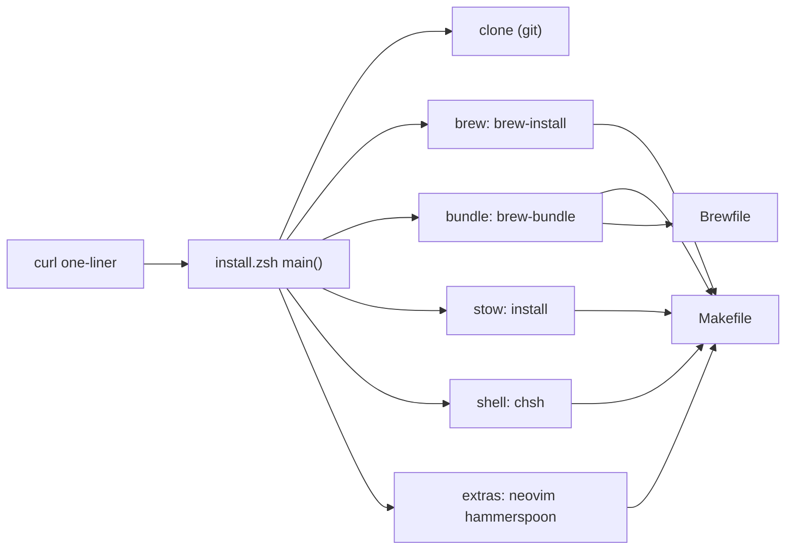

**Related:** [Zsh](../areas/zsh.md) · [Desktop](../areas/desktop.md) · [CLI tools](../areas/cli-tools.md)

`install.zsh` clones the repository and then calls the repository `Makefile`, which installs Homebrew, syncs the `Brewfile`, and symlinks every top-level directory into `$HOME` with GNU Stow. The script is built to run through `curl` on a machine with nothing installed. Two Dockerfiles build container images of the same setup. `.github/tests/install.zsh` checks the installer without installing anything, and `.github/workflows/install.yml` runs that check plus a full one-liner run on a fresh Linux account.

## How it works

The script does only preflight and the first clone. Every other step is a `make` target, so a manual `make install` and the one-liner behave the same (`install.zsh:13-15`). The README documents the one-liner and the flags (`README.md:13-30`).

## The curl one-liner

The README command is `/bin/zsh -c "$(curl -fsSL .../master/install.zsh)"` (`README.md:16`). Zsh assigns the first argument after the command string to `$0`, so flags are passed after a dummy name: `... install.zsh --only stow --dry-run` (`README.md:19-24`, `install.zsh:6-9`).

The whole body is inside functions and the only top-level command is `main "$@"`. A truncated download therefore fails to parse and runs nothing (`install.zsh:306-308`). The raw URL always serves the script from `master`; `--branch` only selects which branch is cloned (`install.zsh:15-17`).

The script defines its own `log::info`, `log::warn`, and `log::error`. The repository versions gate colour on interactivity, and a piped shell is non-interactive, so these gate on `-t` for the output stream instead (`install.zsh:19-24`).

## Arguments and sections

`main` requires zsh 5.8 for `zparseopts -F` (`install.zsh:58-59`). Flags are `--branch`, `--debug`, `--help`, `--dry-run`, `--only`, and `--prefix`, parsed at `install.zsh:88-94`. Behaviours worth knowing:

- Leftover operands abort with `did you mean: install.zsh --only <arg>`, because `-F` rejects unknown options but not operands (`install.zsh:96-102`).
- `--only` is repeatable and comma-separated. An empty value such as `--only ''` fails instead of falling back to the default sections (`install.zsh:122-135`). Unknown section names fail (`install.zsh:137-143`).
- `--dry-run` sets `run` to `builtin print -r --`, so every external command is printed and not run (`install.zsh:112-113`). The Makefile-exists check in `delegate` is skipped in a dry run so a fresh-machine preview works before any clone (`install.zsh:39-46`).
- `--prefix` defaults to `${XDG_CONFIG_HOME:-$HOME/.config}/dotfiles` (`install.zsh:116-119`).

The sections are `clone brew bundle stow shell extras`. The default set is the first four (`install.zsh:62-63`). `shell` and `extras` run only when named with `--only`.

| Section | Action | Source |
|---|---|---|
| `clone` | `git clone --branch <branch>`; fast-forward an existing clone of `vladdoster/dotfiles` | `install.zsh:207-230` |
| `brew` | skip if `brew` is on `PATH`, else `make brew-install` | `install.zsh:235-242` |
| `bundle` | `make brew-bundle`; errors if `brew` is missing | `install.zsh:247-255` |
| `stow` | `make install` | `install.zsh:260-263` |
| `shell` | `make chsh`; refused when non-interactive | `install.zsh:268-275` |
| `extras` | `make neovim`, plus `hammerspoon` on macOS | `install.zsh:280-284` |

### Preflight

Before any section the script does the following.

- It unsets `GIT_CONFIG`, `GIT_DIR`, and `GIT_WORK_TREE`. The stowed zsh environment exports `GIT_CONFIG` pointing at the tracked git config (`zsh/.config/zsh/rc.d/00-env.zsh:19`). Inherited, it breaks the Homebrew installer and makes `git config` writes edit tracked files (`install.zsh:152-155`).
- It sets `NONINTERACTIVE=1` when `CI` is set or stdin is not a TTY, unless the caller already set it (`install.zsh:157-161`).
- On macOS it probes `xcode-select -p` and not `git`, because `/usr/bin/git` is a shim that opens a GUI dialog. Non-interactive runs fail with an instruction. Interactive runs start `xcode-select --install` and poll every 5 seconds, giving up after 1800 seconds (`install.zsh:163-185`).
- On other systems it requires `git` and `make` on `PATH` and prints apt and pacman hints (`install.zsh:187-196`).
- It warns when `stow` is selected, `bundle` is not, and `stow` is missing, and points at `make build-stow` (`install.zsh:198-200`).

### Clone and resume

If `<prefix>/.git` exists and its raw remote.origin.url setting matches `vladdoster/dotfiles`, the script runs `git pull --ff-only` and continues with a warning if that fails. The raw URL is read with `git config` because `git remote get-url` applies `insteadOf` rewrites (`install.zsh:208-215`). Re-running the one-liner after a failure therefore resumes with the latest Makefile. A prefix that exists but is not that clone is refused with removal hints (`install.zsh:216-221`). Otherwise it runs `mkdir -p` on the parent and `git clone` (`install.zsh:222-228`).

### Brew, bundle, delegate

`brew::env` looks for `brew` under `/opt/homebrew`, `/usr/local/Homebrew`, `/home/linuxbrew/.linuxbrew`, or `~/.linuxbrew` using glob qualifiers, then evals `brew shellenv zsh` so delegated targets see it on `PATH` (`install.zsh:26-35`). It is called again after `brew-install` (`install.zsh:239-241`).

`delegate <label> <target>...` runs `make -C <prefix> <targets>` and increments `failures` on error (`install.zsh:41-53`). Sections keep going after a failure; the epilogue returns 1 if any step failed (`install.zsh:289-292`). A failed stow adds a hint about pre-existing files in `$HOME` (`install.zsh:261-262`). On success the script prints next steps, including `bootstrap-macos` on macOS (`install.zsh:297-302`). That is a function under `zsh/.config/zsh/functions/` (see [Zsh](../areas/zsh.md)).

The comment at `install.zsh:37-38` says the Makefile has a catch-all `%:` rule so a mistyped target succeeds silently. No `%:` rule exists in `Makefile` at this commit. A mistyped target would make `make` fail with "No rule to make target".

## Makefile

The Makefile runs recipes under zsh with `pipefail` (`Makefile:3-5`) and is silent by default (`Makefile:1`). Every target of the form `name:` found by grep is marked `.PHONY` (`Makefile:31-32`). Only targets with a trailing `## text` appear in `make help` (`Makefile:28-29`, `Makefile:36-37`). The default goal `all` runs `help` (`Makefile:34`).

### Stow-per-package install

`PACKAGES` is every top-level directory (`$(wildcard */)` with the slash removed) (`Makefile:12`). `install` loops over them and runs `stow --target=$HOME --verbose=1 --restow <pkg>` for each package on its own. A conflict in one package prints `==> skipped <pkg>` to stderr and the loop continues (`Makefile:13`, `Makefile:39-41`). The loop does not set a non-zero exit status, so `make install` succeeds even if packages were skipped. The `delegate` failure hint at `install.zsh:262` therefore fires only if the make invocation itself fails. The e2e test checks the transcript for `==> skipped` instead of relying on the exit status (`.github/tests/e2e.zsh:72`).

`uninstall` stows `--delete` over all packages in a single call (`Makefile:43-45`).

Every top-level directory is a package, including `docker/` and `stow/`. Ignore files control what each package links:

- `.stow-local-ignore` at the repository root ignores `.git`, `.gitignore`, `.local`, `.zsh_history`, `^/.github`, `^/README.*`, `^/install.zsh`, and similar (`.stow-local-ignore:1-14`). Stow reads local ignore files per package, so this file applies when a package is the repository root. Whether it affects the per-package runs above is not determined from the code.
- `docker/.stow-local-ignore` contains the single pattern `.*` (`docker/.stow-local-ignore:1`), which is the ignore list for the `docker` package.
- `stow/.stow-global-ignore` is a package named `stow` containing the global ignore list, so stowing it links the list to `~/.stow-global-ignore` (`stow/.stow-global-ignore:1-21`). The global list ignores `.DS_Store`, VCS metadata, `.local/share`, `.local/bin/python`, and repository-root files such as `README.*` and `LICENSE.*`.

### Homebrew targets

`brew-install` first runs `sudo --validate` when stdin is a TTY and `sudo` exists. `NONINTERACTIVE=1` skips Homebrew's RETURN prompt, but the installer then checks `sudo -n`, which fails on a fresh Mac with no cached credentials. It then pipes the upstream installer through `/bin/bash -c` with `GIT_CONFIG` unset (`Makefile:58-64`).

`brew-bundle` runs `brew bundle install --file=Brewfile --force --force-cleanup --zap` with `HOMEBREW_NO_ENV_HINTS=1` (`Makefile:72-75`).

- `--force-cleanup` uninstalls any formula, cask, or package not listed in the Brewfile. `--zap` makes cask removal delete the cask's associated files as well. Both are repeated in the repository instructions (`AGENTS.md`), which warn that unlisted packages are removed.
- `--verbose` is omitted because verbose mode runs npm with Homebrew's stripped `PATH`, and npm's `#!/usr/bin/env node` then fails (`Makefile:70-71`).

`brew-nuke` prompts for `y`, then uninstalls every brew and cask in the Brewfile with `--force --ignore-dependencies --zap` (`Makefile:77-79`). `brew-uninstall` runs the upstream uninstaller (`Makefile:66-68`). `clean-brew` runs `brew cleanup --prune=all --scrub` (`Makefile:129-130`).

### Other targets

- `chsh` appends zsh to `/etc/shells` if missing, using `sudo tee`, then runs `chsh -s` (`Makefile:54-56`).
- `neovim` and `hammerspoon` clone `vladdoster/<name>-configuration` into `~/.config/nvim` and `~/.hammerspoon` unless the directory exists. Target-specific variables set `destination` (`Makefile:7-9`, `Makefile:47-52`).
- `build-neovim` and `build-stow` compile from source into `~/.local` using `NPROC` jobs (`Makefile:85-97`). `build-stow` is the fallback the installer names when `stow` is missing.
- `safari-extensions` installs `mas` and three App Store IDs (`Makefile:81-83`).
- `release` dispatches the release workflow (`.github/workflows/release.yml`) on `master` through `gh` (`Makefile:123-125`). The workflow itself is documented elsewhere.
- `clean-docker` runs `docker system prune --all --force` (`Makefile:132-133`).

### README table

`update-readme` deletes every line of `README.md` that starts with `|`, then appends a table built from the `## ` comments. The rows come from the same `list-targets` macro as `help`, with a `| %s | %s |` format, and are formatted by `uvx --with mdformat-gfm mdformat -` (`Makefile:135-138`, `Makefile:28-29`). The table is the last block of the README (`README.md:32-58`). The `sed -i ''` form is the BSD syntax, so the target runs on macOS; GNU sed would read `''` as a file name. Add a `## description` to a new target and run `make update-readme` to list it; a target without the comment never appears in `help` or the README.

## Brewfile

`Brewfile` has four groups: CLI formulae, GUI casks, and a `MISC` group of `go`, `npm`, `uv`, and `cargo` entries (`Brewfile:3-4`, `Brewfile:55`, `Brewfile:65-89`). Because `brew-bundle` runs with `--force-cleanup`, anything installed outside this file is removed on the next sync, so a package that a tool in another area needs must be listed here.

- Platform conditions use `if OS.mac?` and `if OS.linux?`: `dockutil`, `gnupg`, `pam-reattach`, and the Safari and QuickLook casks are macOS-only; `glibc` is Linux-only (`Brewfile:15`, `Brewfile:22`, `Brewfile:27`, `Brewfile:43`, `Brewfile:56-59`). The comment at `Brewfile:55` says Homebrew Cask is macOS-only, yet `Brewfile:60-64` lists casks outside the `OS.mac?` block. How `brew bundle` treats those on Linux is not determined from the code.
- `link:` accepts only `true`, `false`, or `:overwrite`. `node` is `link: false` and `node@24` is `link: :overwrite`, so `node@24` provides `node` on `PATH` while the plain `node` formula only supplies the path npm needs (`Brewfile:37-41`). `rust` also uses `:overwrite` (`Brewfile:46`).
- `neovim` builds from source at `HEAD` (`Brewfile:36`). `cargo-update` is a bottled formula because `cargo install` of it fails against Homebrew's OpenSSL 4 (`Brewfile:10-11`).
- `brew bundle` runs npm with only `$HOMEBREW_PREFIX/opt/node/bin` added to `PATH`. The `npm` entries (`Brewfile:68-84`) therefore need `brew "node"` listed (`Brewfile:37-39`).
- `uv "mdformat", with: ["mdformat-gfm"]` supplies the formatter that `update-readme` calls through `uvx` (`Brewfile:86`, `Makefile:138`).

Tools these entries provide are documented in [CLI tools](../areas/cli-tools.md); terminal and window-manager casks (`wezterm@nightly`, fonts) belong to [Desktop](../areas/desktop.md) (`Brewfile:62-64`).

## Docker images

Two Dockerfiles exist. The root `Dockerfile` is built and pushed to `ghcr.io/vladdoster/dotfiles` by the shared workflow containers.yml in the vladdoster/.github repository, called from the `container-image` job in `.github/workflows/release.yml:19-24`. Nothing in this repo builds `arch-linux.Dockerfile`. Both can be built by hand through the Makefile targets below.

- `Dockerfile` starts from `ubuntu:latest`, installs packages with apt, configures the en_US.UTF-8 locale, creates a passwordless-sudo user `dotfiles` (uid 1001), and builds neovim from source into `~/.local` (`Dockerfile:3`, `Dockerfile:19-66`). It copies the working tree into `~/.config/dotfiles` and runs `make --directory=.config/dotfiles --jobs=1 install neovim` inside a login zsh (`Dockerfile:68-70`). The default command is `zsh --login` (`Dockerfile:73`).
- `arch-linux.Dockerfile` starts from `archlinux:base-devel`, installs `yay` from the AUR, installs packages with it, and clones the dotfiles from GitHub and not from the build context. It then runs `make ... install neovim` and `@zinit-scheduler burst` (`arch-linux.Dockerfile:1`, `arch-linux.Dockerfile:51-57`, `arch-linux.Dockerfile:89-95`). The `COPY` lines and the neovim source build are commented out (`arch-linux.Dockerfile:82-87`, `arch-linux.Dockerfile:92`). It still lists `exa`, which the Ubuntu image replaces with `eza` (`arch-linux.Dockerfile:62`, `Dockerfile:25`).
- `.dockerignore` excludes `docker/`, `.DS_Store`, and `bin/**/s**` from the build context (`.dockerignore:1-3`).

Both images install by running `make install neovim`, not `install.zsh`.

The root `Makefile` builds and runs a single-platform image (`Makefile:99-121`). `CONTAINER_ARCH` converts `uname -m` to `amd64` or `arm64`, the image is `vdoster/dotfiles-<arch>:<short sha>`, and `docker-shell` mounts a named volume at `/home` with `seccomp=unconfined` (`Makefile:15-25`). `docker-save` and `docker-load` move the image through a tarball (`Makefile:109-118`). `docker-push` hands off to `docker/Makefile`'s `manifest` target (`Makefile:113-114`).

`docker/Makefile` builds `../Dockerfile` for `linux/amd64` and `linux/arm64` with `buildx --load`, tags each as `docker.io/vdoster/dotfiles-<arch>:<git describe>` and `:latest`, pushes the per-arch images, then creates and pushes a multi-arch manifest (`docker/Makefile:11-47`). The script `docker/init-buildx.sh` creates a `k-release-multiarch` buildx builder with a pinned qemu binfmt image unless the current builder already supports the needed platforms (`docker/init-buildx.sh:52-71`). It is copied from Kubernetes release tooling (`docker/init-buildx.sh:3`). `docker/.stow-local-ignore` keeps the `docker` package from linking these files into `$HOME`.

## CI checks

`.github/workflows/install.yml` runs on pushes and pull requests to `master` that touch `.github/tests/**`, the workflow, `Brewfile`, `Makefile`, or `install.zsh`. It also runs weekly on Monday 06:23 UTC, since Homebrew or package updates can break installs with no commit (`.github/workflows/install.yml:3-25`). It has two jobs.

- `regression` runs `zsh .github/tests/install.zsh` on `macos-latest` and `ubuntu-latest`, installing zsh on Linux first (`.github/workflows/install.yml:35-48`).
- `e2e` runs after `regression` on `ubuntu-latest`, skipped for pull requests from forks because the one-liner clones the upstream repository. It runs `.github/tests/e2e.zsh --branch ... --ref ... --destroy-homebrew` as root with a 120-minute timeout (`.github/workflows/install.yml:49-64`).

### `.github/tests/install.zsh`

This script needs only zsh, git, make, and python3, installs nothing, and runs under a temporary directory with the user's git configuration disabled (`.github/tests/install.zsh:2-17`). Its checks:

- `brew-install` with stand-in `sudo` and `curl` scripts on `PATH` that log their calls. On a pseudo-terminal the log must be `sudo --validate` then the installer with `NONINTERACTIVE=1`. Without a TTY, only the installer (`.github/tests/install.zsh:22-47`).
- The `brew-bundle` dry-run recipe contains `brew bundle install` and neither `--verbose` nor `--jobs` (`.github/tests/install.zsh:49-55`).
- The Brewfile uses only `link:` values `true`, `false`, or `:overwrite`, and lists `brew "node"` whenever it has `npm` entries (`.github/tests/install.zsh:60-75`).
- Option handling: `--help`, a stray operand, an unknown section, and an empty `--only` (`.github/tests/install.zsh:80-92`).
- The clone section against a local bare repository that stands in for GitHub through `url.*.insteadOf`: a fresh clone, a fast-forward, the dry-run text, a diverged clone kept with a warning, and a non-clone directory refused (`.github/tests/install.zsh:97-134`).

The script prints `ok` or `FAIL` per check and exits non-zero on any failure (`.github/tests/install.zsh:136-137`).

### e2e.zsh and terminal.py

`.github/tests/e2e.zsh` must run as root on Linux, requires `--destroy-homebrew` and `--branch`, deletes `/home/linuxbrew`, and recreates the user `dotfiles-e2e` with an empty home and a random password (`.github/tests/e2e.zsh:16-42`). It runs the one-liner, fetched at `--ref`, as that user in a clean environment (`.github/tests/e2e.zsh:24-25`, `.github/tests/e2e.zsh:47-62`). Checks: the first run exits 0, `brew-install` asked for the sudo password, the Homebrew installer did not stop at "press return", no stow package was skipped, `brew bundle check` passes and `node`, `stow`, `zsh` are on `PATH`, a second run reports `updating the existing clone` and `homebrew already installed`, and `--only shell` leaves a zsh login shell (`.github/tests/e2e.zsh:67-87`). The AGENTS file forbids running it locally because it deletes Homebrew.

`.github/tests/terminal.py` runs a command on a pseudo-terminal, copies the output to a transcript, and answers `sudo` and `Password` prompts with `$PTY_PASSWORD`. A secret prompt with no password set kills the command. It also answers the Homebrew "Press RETURN" prompt but counts it, so tests can assert that `NONINTERACTIVE` suppressed it. It prints `prompts: name=count` to stderr and returns the command's exit status (`.github/tests/terminal.py:21-25`, `.github/tests/terminal.py:52-66`). Both test scripts depend on it.

## What it does not cover

The standards and release workflows are not described here. `.github/workflows/install.yml:34-64` has no job that builds either Dockerfile; the image build is in the release workflow.
