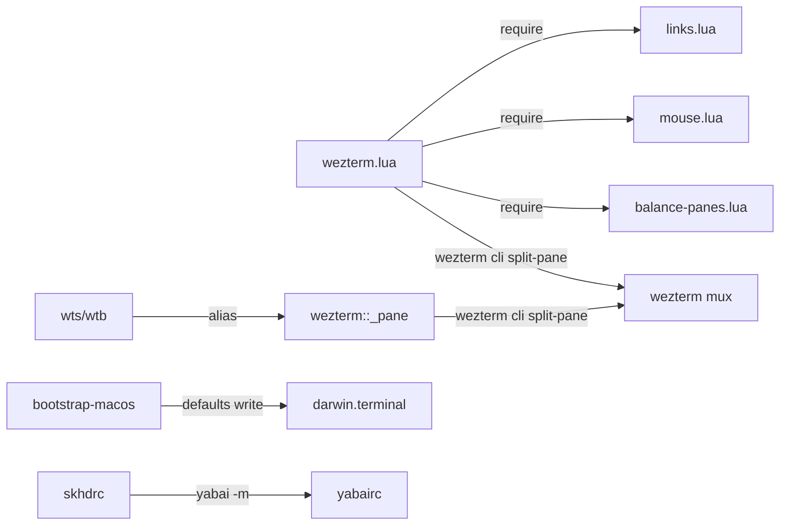

**Related:** [Zsh](zsh.md) · [Bootstrap](bootstrap.md) · [CLI tools](cli-tools.md)

Six stow packages configure the terminal and window layer on macOS: `wezterm` (the daily emulator, with Lua modules), `kitty`, `tmux`, `skhd` and `yabai` (hotkeys and tiling), and `macos` (a Terminal.app profile that `bootstrap-macos` imports). Each package mirrors `$HOME`, so `wezterm/.config/wezterm/wezterm.lua` becomes `~/.config/wezterm/wezterm.lua`. Only the wezterm package has shell-side counterparts: the `wezterm::` zsh functions drive the same pane-moving mechanism from the command line.

## How it works

The packages do not call each other. Their only links are two zsh-side hooks and one bootstrap step.

Only wezterm and tmux have install entries in the Brewfile: `cask "wezterm@nightly"` (`Brewfile:64`) and `brew "tmux"` (`Brewfile:49`). `kitty`, `skhd` and `yabai` do not appear in the Brewfile (grep for them returns nothing), so their installation is not determined from the code.

## WezTerm entry file

`wezterm/.config/wezterm/wezterm.lua` builds a config with `wezterm.config_builder()` (`wezterm/.config/wezterm/wezterm.lua:2`) and returns it (`wezterm/.config/wezterm/wezterm.lua:201`). WezTerm puts the config directory on the Lua package path, which is why the bare `require('links')` works; that behaviour comes from WezTerm and is not visible in the repo.

Load order matters. The two setup modules run first (`wezterm/.config/wezterm/wezterm.lua:7-8`). The file comment says per-field assignments later in the file override module settings if a field is set in both places (`wezterm/.config/wezterm/wezterm.lua:4-6`). The links module owns `hyperlink_rules`; the mouse module owns `mouse_bindings` and mouse options. `balance-panes` is not a setup module: it is required for its `equalize_tab` function (`wezterm/.config/wezterm/wezterm.lua:13`) and used in key actions.

Plain settings (`wezterm/.config/wezterm/wezterm.lua:137-160`): leader is `Ctrl+Space` with a 1000 ms timeout (`wezterm/.config/wezterm/wezterm.lua:137`); the font is `Server Mono` at size 22 with ligatures off through `harfbuzz_features` (`wezterm/.config/wezterm/wezterm.lua:146-149`); color scheme `Windows High Contrast (base16)` (`wezterm/.config/wezterm/wezterm.lua:141`); 100000 scrollback lines (`wezterm/.config/wezterm/wezterm.lua:156`); the tab bar hides with a single tab (`wezterm/.config/wezterm/wezterm.lua:151`); `pane_focus_follows_mouse` is on (`wezterm/.config/wezterm/wezterm.lua:154`); `quit_when_all_windows_are_closed` is false (`wezterm/.config/wezterm/wezterm.lua:155`); native macOS fullscreen is used (`wezterm/.config/wezterm/wezterm.lua:153`). `window_close_confirmation = 'NeverPrompt'` (`wezterm/.config/wezterm/wezterm.lua:188`) and a red `window_frame` border (`wezterm/.config/wezterm/wezterm.lua:190-199`) close the file.

A `gui-startup` handler spawns the first window and maximizes it (`wezterm/.config/wezterm/wezterm.lua:132-135`).

### Key bindings

All bindings live in the keys table (`wezterm/.config/wezterm/wezterm.lua:161-187`):

| Binding | Action |
|---|---|
| `Cmd+W` | close pane, with confirmation (`wezterm/.config/wezterm/wezterm.lua:162`) |
| `Cmd+Enter` | split right, 50 percent (`wezterm/.config/wezterm/wezterm.lua:169`) |
| `Cmd+Shift+Enter` | split down, 50 percent (`wezterm/.config/wezterm/wezterm.lua:164-168`) |
| `Alt+Ctrl+F` | toggle fullscreen (`wezterm/.config/wezterm/wezterm.lua:170`) |
| `Cmd+Shift+T` | break pane into a new tab (`wezterm/.config/wezterm/wezterm.lua:171`) |
| `Cmd+Shift+B` | bring a pane from another tab here (`wezterm/.config/wezterm/wezterm.lua:172`) |
| `Cmd+Shift+S` | send this pane to another tab (`wezterm/.config/wezterm/wezterm.lua:173`) |
| `Leader l` | launcher (`wezterm/.config/wezterm/wezterm.lua:163`) |
| `Leader =` | equalize panes (`wezterm/.config/wezterm/wezterm.lua:174-178`) |
| `Leader q` | close pane without confirmation, then equalize (`wezterm/.config/wezterm/wezterm.lua:179-186`) |

The plain splits at `Cmd+Enter` do not equalize; only `Leader =` and `Leader q` call `equalize_tab`. The balance-panes module also exports `split_and_equalize` (`wezterm/.config/wezterm/balance-panes.lua:332`), which the entry file does not import, and its leader-key examples at `wezterm/.config/wezterm/balance-panes.lua:315-330` are comments.

### Moving panes between tabs

WezTerm's Lua API has no call that moves a pane into an existing tab, so `move_pane_action` shells out to `wezterm cli split-pane --move-pane-id` (comment at `wezterm/.config/wezterm/wezterm.lua:15-17`; call at `wezterm/.config/wezterm/wezterm.lua:96-106`). `wezterm_bin` is `wezterm.executable_dir .. '/wezterm'` (`wezterm/.config/wezterm/wezterm.lua:18`).

The action builds a choice list from every mux window and every tab except the current one (`wezterm/.config/wezterm/wezterm.lua:46-70`). Labels read `[workspace] wN tN` (workspace prefix omitted for `default`), then the tab or pane title and the cwd with `$HOME` shortened to `~` (`wezterm/.config/wezterm/wezterm.lua:21-39`). In `send` mode each choice is a tab, identified by its active pane; in `bring` mode each choice is a single pane of every other tab (`wezterm/.config/wezterm/wezterm.lua:52-66`). The choices open in a fuzzy `InputSelector` (`wezterm/.config/wezterm/wezterm.lua:82-87`). On selection the callback assigns `target_id` and `moved_id`: for send, the chosen pane is the split target and the current pane moves; for bring, the reverse (`wezterm/.config/wezterm/wezterm.lua:91-95`). On success the moved pane is activated and the OS window is focused for cross-window moves (`wezterm/.config/wezterm/wezterm.lua:107-115`); on failure a toast shows stderr (`wezterm/.config/wezterm/wezterm.lua:117`).

Empty-choice edge case: `send` with no other tab moves the pane into a new tab; `bring` shows a toast (`wezterm/.config/wezterm/wezterm.lua:72-80`). The split side is hard-coded to `--right` (`wezterm/.config/wezterm/wezterm.lua:101`), while the zsh functions take a direction option.

## balance-panes module

`equalize_tab(window)` (`wezterm/.config/wezterm/balance-panes.lua:13`) gives every column equal width and every row inside a column equal height. It returns early with one pane (`wezterm/.config/wezterm/balance-panes.lua:16-18`) and restores the originally active pane at the end by index (`wezterm/.config/wezterm/balance-panes.lua:20-23`, `wezterm/.config/wezterm/balance-panes.lua:300`).

The problem it solves is stated in the header comment (`wezterm/.config/wezterm/balance-panes.lua:8-12`): `AdjustPaneSize` acts on the nearest ancestor split in WezTerm's internal tree, which can differ from any tree rebuilt from pane geometry, because several binary trees produce the same pixel layout. The module therefore discovers by experiment which pane resizes which boundary.

Steps:

1. `build_tree` rebuilds a binary split tree from `panes_with_info()` geometry. It tries each distinct right edge as a vertical cut, requiring every pane to fall entirely on one side, then does the same with bottom edges for horizontal cuts (`wezterm/.config/wezterm/balance-panes.lua:28-96`; the vsplit node is built at `wezterm/.config/wezterm/balance-panes.lua:55` and the hsplit node at `wezterm/.config/wezterm/balance-panes.lua:86`). Anything that cannot be cut becomes a leaf (`wezterm/.config/wezterm/balance-panes.lua:95`).
2. The target size of a vertical split's first child is `floor(total * left_columns / (left_columns + right_columns))`, using `count_columns` for the weights (`wezterm/.config/wezterm/balance-panes.lua:248`). Horizontal splits use `count_rows` the same way (`wezterm/.config/wezterm/balance-panes.lua:273`). The weights count column and row groups, so mixed split orientations end with equal columns and equal rows.
3. A breadth-first walk finds the shallowest split whose first child has the wrong size (`wezterm/.config/wezterm/balance-panes.lua:239-294`). The tree is rebuilt after each adjustment, and the outer loop runs at most `#initial_panes - 1` times (`wezterm/.config/wezterm/balance-panes.lua:234`) and stops when nothing was adjusted (`wezterm/.config/wezterm/balance-panes.lua:295-296`).
4. For the unbalanced split, every pane in both children is a candidate (`wezterm/.config/wezterm/balance-panes.lua:255-262`). `probe` activates a candidate, grows it by one cell, snapshots sizes, and undoes the change (`wezterm/.config/wezterm/balance-panes.lua:164-180`). A candidate qualifies only when both it and a verification pane on the other side changed size, by different amounts (`wezterm/.config/wezterm/balance-panes.lua:176`). The result, `grow` or `shrink`, tells `try_adjust` which direction applies the wanted delta, with the sign flipped for candidates on the far side of the boundary (`wezterm/.config/wezterm/balance-panes.lua:188-231`).

Each probe and adjustment is a real `perform_action` call, so a large layout runs many resize actions per equalize. The module cites no timing; the cost was not determined from the code.

## links.lua and mouse.lua

Both modules export `setup(config)` and mutate the config in place (`wezterm/.config/wezterm/links.lua:5`, `wezterm/.config/wezterm/mouse.lua:7`).

The links module replaces `hyperlink_rules` with five rules (`wezterm/.config/wezterm/links.lua:6-40`): URLs with a TLD host (`wezterm/.config/wezterm/links.lua:10-13`), email to `mailto:` (`wezterm/.config/wezterm/links.lua:16-19`), `file://` URIs (`wezterm/.config/wezterm/links.lua:22-25`), URLs with numeric IPv4 hosts (`wezterm/.config/wezterm/links.lua:29-32`), and a last rule that turns `user/project` text into `https://www.github.com/$1/$3` (`wezterm/.config/wezterm/links.lua:36-39`). The first four are copies of WezTerm's compiled-in defaults, per the inline comments; the GitHub rule is the addition. Because it matches any `word/word` token, paths such as `usr/local` become GitHub links. Order matters, since the comment relies on the full-URL rule matching first (`wezterm/.config/wezterm/links.lua:33-35`).

The mouse module sets `bypass_mouse_reporting_modifiers = 'CTRL'` and a wheel scroll speed of 1 in alternate screen (`wezterm/.config/wezterm/mouse.lua:8-9`). It rebinds the left-button release (`wezterm/.config/wezterm/mouse.lua:10-21`): an unmodified release only completes the selection and copies to clipboard and primary selection, so a plain click does not open a link; `Ctrl` plus release calls `CompleteSelectionOrOpenLinkAtMouseCursor`. A commented `require("keys")` at `wezterm/.config/wezterm/mouse.lua:2` refers to a module that does not exist in the package.

## Zsh counterpart

`zsh/.config/zsh/functions/wezterm::send-pane`, `wezterm::bring-pane` and the shared `wezterm::_pane` do the same move from the shell. The public functions parse options (`--left/--right/--top/--bottom`, `--stay`, `--list`, `--debug`) with `zparseopts` and then call `wezterm::_pane <send|bring> <direction> <stay> <list> [tab]` (`zsh/.config/zsh/functions/wezterm::send-pane:12-18`, `zsh/.config/zsh/functions/wezterm::send-pane:45`). `wezterm::_pane` requires `wezterm` and `jq`, and `WEZTERM_PANE` to be set (`zsh/.config/zsh/functions/wezterm::_pane:22-28`). It reads `wezterm cli --no-auto-start list --format=json` (`zsh/.config/zsh/functions/wezterm::_pane:36`), resolves a tab by exact title first and numeric id second, excludes the current tab, picks the target tab's active pane (`zsh/.config/zsh/functions/wezterm::_pane:56-73`), then runs `split-pane --pane-id ... --move-pane-id ...` with the two ids swapped between modes (`zsh/.config/zsh/functions/wezterm::_pane:90-100`). With no tab argument it lists tabs and exits (`zsh/.config/zsh/functions/wezterm::_pane:41-53`). The aliases `wts` and `wtb` point at the two functions (`zsh/.config/zsh/rc.d/01-alias.zsh:90-91`), and each has a completion file under `zsh/.config/zsh/completions/`. See [Zsh](zsh.md) for the autoload and completion conventions. The alias `wezrc` opens the wezterm config and `tmuxrc` opens the tmux config through `edit_targets` (`zsh/.config/zsh/rc.d/01-alias.zsh:60`).

The Lua action and the zsh function are separate implementations of one mechanism. They differ in two ways: the Lua picker always splits right (`wezterm/.config/wezterm/wezterm.lua:101`), and the zsh function accepts a direction and `--stay`.

## skhd and yabai

`skhd/.config/skhd/skhdrc` binds hotkeys to `yabai -m` commands; the first 68 lines are skhd's grammar reference comment (`skhd/.config/skhd/skhdrc:3-68`). All focus, display and float-move bindings are commented out (`skhd/.config/skhd/skhdrc:70-74`, `skhd/.config/skhd/skhdrc:94-104`). Active bindings, by group:

| Group | Keys | Command |
|---|---|---|
| Swap tiled window | `shift+ctrl-h/j/k/l` | `window --swap west/south/north/east` (`skhd/.config/skhd/skhdrc:77-80`) |
| Grow window | `ctrl+alt-h/j/k/l` | `window --resize` left/top/bottom/right with a +20 delta (`skhd/.config/skhd/skhdrc:83-86`) |
| Shrink window | `shift+ctrl+alt-h/j/k/l` | the same edges with a -20 delta (`skhd/.config/skhd/skhdrc:89-92`) |
| Zoom | `alt-z` | `--toggle zoom-parent` (`skhd/.config/skhd/skhdrc:108`) |
| Float | `alt-f` | toggle float, then `--grid 4:4:1:1:2:2` to center it (`skhd/.config/skhd/skhdrc:114-115`) |
| Sticky | `shift+ctrl-p` | toggle sticky, topmost, pip (`skhd/.config/skhd/skhdrc:118-120`) |
| Corner pin | `shift+alt-p` | toggle sticky, topmost, grid `5:5:4:0:1:1` (`skhd/.config/skhd/skhdrc:122-124`) |

The grow bindings use letter keys that mirror vim movement, but each key resizes a different edge from its direction: `h` moves the left edge outward, `j` the top, `k` the bottom, `l` the right (`skhd/.config/skhd/skhdrc:83-86`). Shrink uses the same letters with the opposite deltas. Whether those edge assignments are intended was not determined from the code.

`yabai/.config/yabai/yabairc` is an `sh` script that skhd does not read. It registers a `dock_did_restart` signal that runs `sudo yabai --load-sa`, and runs the same command once at startup (`yabai/.config/yabai/yabairc:3-4`). The scripting addition needs passwordless sudo for that command; where sudoers is configured is not determined from the code. One `yabai -m config` call sets all options (`yabai/.config/yabai/yabairc:6-28`). Layout: 12 px padding on all four sides, 06 gap, `split_type auto`, `split_ratio 0.50`, new windows placed as second child, `auto_balance off` (`yabai/.config/yabai/yabairc:7-27`). Mouse: `fn` is the modifier, `mouse_action1 move`, `mouse_action2 resize`, drop swaps (`yabai/.config/yabai/yabairc:13-17`). Focus follows neither mouse nor focus (`yabai/.config/yabai/yabairc:10`, `yabai/.config/yabai/yabairc:16`), and animations are zero length (`yabai/.config/yabai/yabairc:22`).

## tmux

`tmux/.config/tmux/tmux.conf` is one file in three parts.

Settings (`tmux/.config/tmux/tmux.conf:3-15`): the default command is `$(which zsh) || ${SHELL}` (`tmux/.config/tmux/tmux.conf:3`); `default-terminal` is `xterm-256color` (`tmux/.config/tmux/tmux.conf:5`); focus events, mouse, titles, vi status and mode keys are on; `escape-time` is 0; `aggressive-resize` and `automatic-rename` are set per window.

Bindings (`tmux/.config/tmux/tmux.conf:17-44`): prefix moves from `C-b` to `C-a` (`tmux/.config/tmux/tmux.conf:17-18`); `C-a C-a` selects the last window and `a` sends the prefix through (`tmux/.config/tmux/tmux.conf:20-21`). Windows: `c` new, `C` kill, repeatable `n`/`N` next and previous (`tmux/.config/tmux/tmux.conf:22-25`). Panes: `v` splits horizontally and `s` vertically, both in the current path; `x` kills (`tmux/.config/tmux/tmux.conf:27-29`). Navigation uses `h/j/k/l`; repeatable `H/J/K/L` resize by 5 (`tmux/.config/tmux/tmux.conf:31-39`). `S` toggles `synchronize-panes`, `T` opens `choose-tree -Z` (`tmux/.config/tmux/tmux.conf:40-41`). Copy mode binds `v` to begin selection and `y` to pipe to `xclip -selection clipboard -in` (`tmux/.config/tmux/tmux.conf:42-43`). `p` opens a popup shell in the pane's directory (`tmux/.config/tmux/tmux.conf:44`). `R` reloads the file from `${XDG_CONFIG_HOME}/tmux/tmux.conf` (`tmux/.config/tmux/tmux.conf:19`), so the variable has to be set in tmux's environment.

The `y` binding calls `xclip`, which is not a macOS tool and is not in the Brewfile (not found by grep); on macOS the copy would fail unless `xclip` is installed elsewhere. By contrast, the zsh clipboard layer handles tmux itself through `tmux load-buffer` when `$TMUX` is set (`zsh/.config/zsh/rc.d/04-clipboard.zsh:72-74`).

Appearance (`tmux/.config/tmux/tmux.conf:46-69`): status bar on top, centered, black and white with `colour34` accents, `status-left` showing the title (`tmux/.config/tmux/tmux.conf:54`), and `status-right` with `tmux-mem-cpu-load`, date and time, and hostname (`tmux/.config/tmux/tmux.conf:57-60`). `tmux-mem-cpu-load` comes from a zinit plugin (`zsh/.config/zsh/rc.d/05-zinit.zsh:116`). `status-interval` is set to 1 at line 47 and then to 2 at line 69; the later value applies.

## kitty

`kitty/.config/kitty/kitty.conf` is a full options file in marker-folded sections. `kitty_mod` is `cmd+shift` (`kitty/.config/kitty/kitty.conf:1`). Font is BlexMono Nerd Font Mono at 18 (`kitty/.config/kitty/kitty.conf:8-9`). Layout is limited to `splits:split_axis=vertical` (`kitty/.config/kitty/kitty.conf:57`). Remote control accepts socket connections only (`kitty/.config/kitty/kitty.conf:134`), `term` is `xterm-kitty` (`kitty/.config/kitty/kitty.conf:138`), and `macos_option_as_alt` is on (`kitty/.config/kitty/kitty.conf:146`).

Colors: the file sets `color0` to `color15`, `foreground` and `background` (`kitty/.config/kitty/kitty.conf:96-120`), then `include dracula.conf` at `kitty/.config/kitty/kitty.conf:121`. kitty applies later definitions over earlier ones, so Dracula values override the preceding palette, while `selection_foreground`/`selection_background` at `kitty/.config/kitty/kitty.conf:129-130` come after the include and win over Dracula's selection colors (`kitty/.config/kitty/dracula.conf:13-14`). Both files set `background #000000`.

Shortcuts: `clear_all_shortcuts no` (`kitty/.config/kitty/kitty.conf:155`) keeps kitty's defaults, then the file adds `kitty_mod` maps for clipboard, scrolling, windows, tabs, font size and miscellany (`kitty/.config/kitty/kitty.conf:156-215`). `cmd+enter` launches a vertical split in the current directory (`kitty/.config/kitty/kitty.conf:179`). `kitty_mod+f` is mapped twice, to `move_window_forward` (`kitty/.config/kitty/kitty.conf:185`) and `toggle_fullscreen` (`kitty/.config/kitty/kitty.conf:210`); the later definition takes effect under kitty's override rule.

## macOS Terminal profile

`macos/.config/macos/darwin.terminal` is a 294-line XML plist for Terminal.app, with profile `name` `darwin` and `type` `Window Settings` (`macos/.config/macos/darwin.terminal:289-292`). Colors and the font are base64 `NSKeyedArchiver` blobs, so they are not hand-editable; plain keys include `Bell` and `VisualBell` false, `CursorBlink` true and `RunCommandAsShell` true (`macos/.config/macos/darwin.terminal:21-28`, `macos/.config/macos/darwin.terminal:57`). The font blob contains the name `ServerMono-Regular` when base64-decoded (`macos/.config/macos/darwin.terminal:44-52`); its size was not decoded.

`bootstrap-macos` imports it in its `dockitems` section (`zsh/.config/zsh/functions/bootstrap-macos:242`). It resolves the file under `$XDG_CONFIG_HOME/macos`, falling back to `$DOTFILES/macos/.config/macos` (`zsh/.config/zsh/functions/bootstrap-macos:279-280`), reads the profile name with `PlistBuddy` (`zsh/.config/zsh/functions/bootstrap-macos:290`), runs `defaults write com.apple.Terminal "Window Settings" -dict-add` (`zsh/.config/zsh/functions/bootstrap-macos:301-302`), and sets both `Default Window Settings` and `Startup Window Settings` to that name (`zsh/.config/zsh/functions/bootstrap-macos:304-305`). A missing file or name counts as a failure and skips the import (`zsh/.config/zsh/functions/bootstrap-macos:282`, `zsh/.config/zsh/functions/bootstrap-macos:293`). See [Bootstrap](bootstrap.md).

## Where to look

- `wezterm/.config/wezterm/wezterm.lua`: settings, keys, pane-move picker, load order.
- `wezterm/.config/wezterm/balance-panes.lua`: equalize algorithm; read the header comment first.
- `skhd/.config/skhd/skhdrc` and `yabai/.config/yabai/yabairc`: hotkeys and tiling options.
- `tmux/.config/tmux/tmux.conf`: prefix, bindings and status bar.
- `zsh/.config/zsh/functions/wezterm::_pane`: shell counterpart of the move-pane action.
