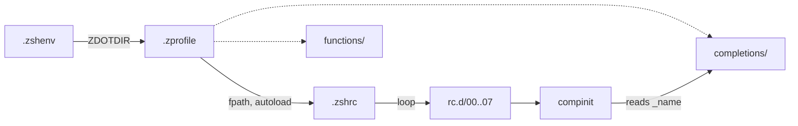

**Related:** [Bootstrap](bootstrap.md) · [Desktop](desktop.md) · [CLI tools](cli-tools.md)

The `zsh` stow package holds the interactive shell: three startup files, eight numbered rc.d files that set the environment, aliases, key widgets, plugins, completion styles and the prompt, and about 67 autoloaded functions each paired with a completion. `zsh/.zshenv` is the only file linked directly into `$HOME`; everything else lands under `~/.config/zsh` (`zsh/.zshenv:6`). This doc covers how the pieces load and connect. The five child docs hold the per-file detail.

## How it works

A shell start has two independent paths. The startup chain sets options, sources rc.d, and runs `compinit`. Function loading happens earlier, in `.zprofile`, which puts `functions/` and `completions/` on `fpath` and autoloads every function file (`zsh/.config/zsh/.zprofile:39-40`).

### Startup order

1. `.zshenv` runs for every zsh, including scripts. It only sets `ZDOTDIR` to `$HOME/.config/zsh` when unset (`zsh/.zshenv:6`).
2. `.zprofile` runs for login shells. It sets up Homebrew, `PATH` entries for `~/.local/bin`, `~/.cargo/bin` and Go, and the `fpath`/autoload step (`zsh/.config/zsh/.zprofile:23-40`). `.zshrc` sources it itself when the shell is not a login shell, so the paths and autoloads exist in every interactive shell (`zsh/.config/zsh/.zshrc:14`).
3. `.zshrc` sets options and history, then sources each `rc.d/<digits>-*zsh` file in numeric order unless `NO_RC` is non-empty (`zsh/.config/zsh/.zshrc:23-27`). Then it calls `compinit` (`zsh/.config/zsh/.zshrc:29-30`).

The rc.d stages are `00-env` (exports, `DOTFILES`), `01-alias`, `02-widget`, `03-fzf`, `04-clipboard`, `05-zinit` (plugins and release binaries), `06-completion` (styles, run before `compinit`) and `07-prompt`. The root `AGENTS.md` also lists a ninth stage called `repeat`; no such file exists at HEAD. The only mention in the function tree is the `mkrepeat` header comment, which says to call it from rc.d, and no rc.d file does (see [Function tooling](../components/zsh/function-tooling.md)). Each file's contents are in [Startup](../components/zsh/startup.md).

Because rc.d files are sourced, not run, a new file needs a numeric prefix and a name ending in `zsh` to load. Ordering matters in three places: `05-zinit` installs fzf after `03-fzf` has already checked for it; `06-completion` sets styles before `compinit`; and `compinit` comes after every `compdef` call in rc.d. The children describe each consequence.

### Skip switches

`NO_RC=1` skips the whole rc.d loop. `NO_ZINIT=1` makes 05-zinit.zsh return early so later stages still load (`zsh/.config/zsh/rc.d/05-zinit.zsh:6-10`). `zsh::rld` sets `NO_ZINIT` when asked, and validates a reload by running `zsh -ilc exit` before it execs a new shell (`zsh/.config/zsh/functions/zsh::rld:33-52`).

## Functions and completions

Each file in `functions/` is a bare function body marked `#autoload`, named for the function. Names with `::` group related functions (`log::info`, `wezterm::send-pane`, `macos::rm-ds-store`). The autoload line in `.zprofile` skips `*.md` and `*.zwc` files, so `zsh/.config/zsh/functions/AGENTS.md` is not loaded as a function (`zsh/.config/zsh/.zprofile:40`). `r` re-runs the same autoload after unfunctioning each name, which picks up edits without a new shell (`zsh/.config/zsh/functions/r:29-34`).

Every function except the exempt internal helper `wezterm::_pane` has a completion file `completions/_<name>` starting with `#compdef <name>`. `compinit` finds these through `fpath` and binds them. The rule, the helper exemption and the templates are in `zsh/.config/zsh/functions/AGENTS.md:3-12`; a new function therefore means two files, plus a rebuild of functions.zwc if one exists (`zsh/.config/zsh/functions/AGENTS.md:13`). Nothing in the repository creates that digest, and `*.zwc` is gitignored (`.gitignore:11`), so how it is built is not determined from the code. `mkfn` writes only the function skeleton, so the completion is added by hand. `zsh/.config/zsh/completions/AGENTS.md` is a guide to writing completions and is not itself a completion.

Two completion files are not per-function. `_complete_dots_last` is a completer named in the `zstyle` completer list (`zsh/.config/zsh/rc.d/06-completion.zsh:25`), and several tools get their completion from zinit plugins or from `load-comp` at runtime, not from this directory.

## How the five groups fit together

The groups are split by job, not by directory; all functions share `functions/` and `completions/`.

- [Startup](../components/zsh/startup.md) is the loaded chain above and everything rc.d does. It is the only group with code that runs at every shell start.
- [Function tooling](../components/zsh/function-tooling.md) is what manages the other four groups: creating, reloading, finding and editing functions and completions, plus the `log::info`, `log::error` and `has` helpers that 05-zinit.zsh and many functions call.
- [Everyday utilities](../components/zsh/everyday-utilities.md), [System maintenance](../components/zsh/system-maintenance.md) and [Dev and terminal](../components/zsh/dev-and-terminal.md) are the leaf functions that run on demand. They depend on function tooling for logging and on startup for `PATH`, `EDITOR` and aliases, and nothing in rc.d calls them directly.

Aliases connect the layers: 01-alias.zsh maps short names to functions, for example `wts` and `wtb` to the two `wezterm::` functions (`zsh/.config/zsh/rc.d/01-alias.zsh:90-91`). A command name with no file in `functions/` is usually an alias there or a binary installed by 05-zinit.zsh.

## Contract with other areas

- **Bootstrap.** `install.zsh` and the `Makefile` stow this package like any other and run `make chsh` for the `shell` section (`Makefile:54-56`). `install.zsh` only prints `bootstrap-macos` as a next step on macOS (`install.zsh:302`); the function itself lives in `functions/` and is documented in [System maintenance](../components/zsh/system-maintenance.md). The installer unsets `GIT_CONFIG` before cloning because 00-env.zsh exports it (`install.zsh:152-155`, `zsh/.config/zsh/rc.d/00-env.zsh:19`). See [Bootstrap](bootstrap.md).
- **Desktop.** The `wezterm::send-pane` and `wezterm::bring-pane` functions drive the same pane-move that `wezterm/.config/wezterm/wezterm.lua` implements in Lua; the shell side is in [Dev and terminal](../components/zsh/dev-and-terminal.md). `bootstrap-macos` imports the Terminal.app profile that the `macos` package ships. The tmux config reads its memory display from a binary installed by `zsh/.config/zsh/rc.d/05-zinit.zsh:116`. See [Desktop](desktop.md).
- **CLI tools.** 00-env.zsh points programs at config files in other packages, and `~/.local/bin` comes from the `.zprofile` path list (`zsh/.config/zsh/.zprofile:34`). See [CLI tools](cli-tools.md).

## What's below

- **[Startup](../components/zsh/startup.md)** covers the three startup files, every rc.d stage, the zinit plugin list, completion styles and the prompt.
- **[Function tooling](../components/zsh/function-tooling.md)** covers the functions that create, reload, find and edit other functions and completions, and the shared log and lookup helpers.
- **[Everyday utilities](../components/zsh/everyday-utilities.md)** covers small interactive functions for directory jumps, archive extraction, `PATH` edits and text output.
- **[System maintenance](../components/zsh/system-maintenance.md)** covers `bootstrap-macos`, `sys-report`, keg linking and the update checkers.
- **[Dev and terminal](../components/zsh/dev-and-terminal.md)** covers the Docker sandbox, WezTerm pane and git browsing functions.
