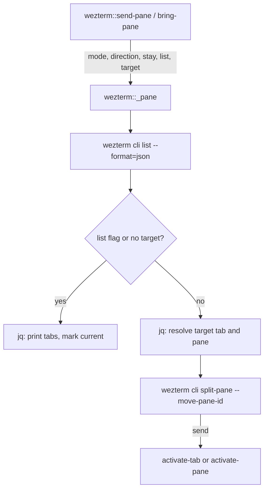

**Related:** [Zsh](../../areas/zsh.md) · [Function tooling](function-tooling.md) · [Everyday utilities](everyday-utilities.md) · [Desktop](../../areas/desktop.md)

Eight autoloaded functions for developer workflows: `dkr` and `docker::shell` build and start Docker sandboxes, `ls-containers` counts running containers, `wezterm::send-pane` and `wezterm::bring-pane` move panes between WezTerm tabs, `gli` browses `git log` in fzf, and `fgco` checks out a branch chosen in fzf. `wezterm::_pane` is the shared helper behind the two pane commands. Each public function has a completion in `zsh/.config/zsh/completions/`; the helper has none, and the functions rules list it as exempt (`zsh/.config/zsh/functions/AGENTS.md`). The WezTerm configuration lives in the desktop area; this doc covers only the shell side of pane moves.

## How it works

Every file is an `#autoload` function file whose body runs as the function (`zsh/.config/zsh/functions/fgco:1`). Most start with `emulate -L zsh` and report failures through `log::error` (for example `zsh/.config/zsh/functions/fgco:14`), which is defined in the `log::error` function file owned by another doc. Option parsing uses `zparseopts -D -F -K` after `zmodload zsh/zutil` (`zsh/.config/zsh/functions/docker::shell:10-20`). External tools are called through `command` so aliases do not intercept them.

`dkr` is the exception: its file defines `dkr::*` helper functions first, then runs the dispatch code at file level (`zsh/.config/zsh/functions/dkr:336-382`). Because the file is the function body, the helpers are redefined on every call.

## dkr: sandbox images and cleanup

`dkr` accepts `-h`, `-v` and two commands, `nuke` and `sandbox`. With no argument, or a blank first argument, it prints an ASCII banner and the usage text (`zsh/.config/zsh/functions/dkr:353-368`). Dispatch checks the command against a declared list, so the internal `dkr::*` helpers cannot be called as subcommands (`zsh/.config/zsh/functions/dkr:373-382`).

`dkr::running` waits for the Docker daemon: it runs `docker system info` up to four times with a 500 ms `zselect` pause between tries, and fails if none succeeds (`zsh/.config/zsh/functions/dkr:20-29`). Both `nuke` and `sandbox` call it first (`zsh/.config/zsh/functions/dkr:269`, `zsh/.config/zsh/functions/dkr:296`).

`dkr sandbox [-d distro] [-p platform] build|run` parses its options, then looks up the subcommand as `dkr::sandbox_<name>` (`zsh/.config/zsh/functions/dkr:251-273`). Defaults are `debian` and `arm64` (`zsh/.config/zsh/functions/dkr:253`). The chosen `distro` and `platform` are passed to `dkr::sandbox_build` and `dkr::sandbox_run` as local variables through zsh dynamic scoping (`zsh/.config/zsh/functions/dkr:270-272`).

- `dkr::sandbox_build` holds one Dockerfile per distro in a `case`: `zinit`, `alpine`, and `debian | ubuntu` share a body with `DISTRO` as a build arg; anything else exits with an error (`zsh/.config/zsh/functions/dkr:40-231`). The Dockerfile text is piped to `docker buildx build` on stdin and tagged `sbox-<distro>-<platform>:latest` (`zsh/.config/zsh/functions/dkr:233`).
- The `zinit` branch builds `zinit-minimal:latest` for `linux/amd64` regardless of `--platform`, then returns early (`zsh/.config/zsh/functions/dkr:119-122`). The `alpine` and `debian`/`ubuntu` images clone the dotfiles repository into the container user's home (`zsh/.config/zsh/functions/dkr:155-156`, `zsh/.config/zsh/functions/dkr:223-224`).
- `dkr::sandbox_run` starts the image with a named volume mounted at `/home` (`/root` for `zinit`) so state persists between runs (`zsh/.config/zsh/functions/dkr:31-38`). It does not build a missing image; run `build` first.

`dkr nuke [--volumes]` removes every container and image with `docker <resource> rm --force`, then runs `docker system prune --all --force` (`zsh/.config/zsh/functions/dkr:300-309`). With `--volumes` it afterwards removes every volume, after the prune has removed stopped containers that would hold them (`zsh/.config/zsh/functions/dkr:310-316`). It asks for no confirmation.

`dkr::sandbox_usage` and `dkr::usage` describe `run` and `sandbox` as an "ubuntu" sandbox although the default distro is `debian` (`zsh/.config/zsh/functions/dkr:248`, `zsh/.config/zsh/functions/dkr:330`).

The completion `_dkr` lists both commands, the `build` and `run` subcommands, and `--volumes` for `nuke`. Its distro list is `alpine debian ubuntu zinit` and its platform list is `amd64 arm64 arm64v8` (`zsh/.config/zsh/completions/_dkr:44`). The dispatcher accepts any platform string; the list only drives completion. Adding a distro means editing the `case` in `dkr::sandbox_build` and the `distros` array in `_dkr`.

## docker::shell and ls-containers

`docker::shell [-f Dockerfile] [-t tag] [-v]` is a smaller path to the same result. The default tag is `dev-sandbox` and the platform is always `linux/x86_64` (`zsh/.config/zsh/functions/docker::shell:12`, `zsh/.config/zsh/functions/docker::shell:36-42`). With `--file` it builds that Dockerfile with `USER` as a build arg, then runs the image as `$USER` with `seccomp=unconfined` (`zsh/.config/zsh/functions/docker::shell:44-61`). Without it, the function asks `Build Ubuntu container? [y/N]` through `read -q`, builds an inline Ubuntu Dockerfile from stdin, and starts it (`zsh/.config/zsh/functions/docker::shell:64-112`). `--verbose` switches buildx progress from `auto` to `plain` (`zsh/.config/zsh/functions/docker::shell:31`). A missing `docker` binary fails early (`zsh/.config/zsh/functions/docker::shell:29`).

`ls-containers` runs `watch` on a `figlet` banner showing the output of `docker ps --quiet | wc -l` (`zsh/.config/zsh/functions/ls-containers:8`). It takes no arguments; its completion prints "no arguments" (`zsh/.config/zsh/completions/_ls-containers:3`).

## WezTerm pane moves

`wezterm::send-pane` moves the current pane into another tab as a split. `wezterm::bring-pane` pulls the target tab's active pane into the current tab. The two public files parse options (`--left|--right|--top|--bottom`, `-l/--list`, `-d/--debug`, and `-s/--stay` for send only), default the direction to `--right`, reject more than one direction, and call the helper (`zsh/.config/zsh/functions/wezterm::send-pane:12-45`, `zsh/.config/zsh/functions/wezterm::bring-pane:12-43`). Each keeps its own help text so messages carry the name the user typed; the helper recovers it from `funcstack[2]` (`zsh/.config/zsh/functions/wezterm::_pane:16`).

`wezterm::_pane <send|bring> <direction> <stay> <list> [target]` does the work (`zsh/.config/zsh/functions/wezterm::_pane:6`):

- It requires `wezterm` and `jq` on `PATH`, a set `WEZTERM_PANE`, and at most one target argument (`zsh/.config/zsh/functions/wezterm::_pane:22-33`).
- It reads all panes from `wezterm cli --no-auto-start list --format=json` (`zsh/.config/zsh/functions/wezterm::_pane:36`).
- With `--list` or no target, a `jq` program groups panes by tab and prints a marker for the current tab, window id, tab id, title and pane titles, then returns (`zsh/.config/zsh/functions/wezterm::_pane:41-53`).
- Otherwise one `jq` call resolves the target. An exact tab title match wins; only if no title matches and the argument is all digits is it treated as a tab id. The current tab is excluded from matches. The target pane is the tab's active pane, or its first pane (`zsh/.config/zsh/functions/wezterm::_pane:56-73`).
- Errors cover a missing pane in the mux, no match (with a tab list and a hint to run `wezterm cli set-tab-title`), and the target being the current tab (`zsh/.config/zsh/functions/wezterm::_pane:78-90`). Multiple matches print a warning and use the first (`zsh/.config/zsh/functions/wezterm::_pane:92-93`).
- The move is `wezterm cli split-pane <direction>` with `--pane-id` and `--move-pane-id` swapped by mode: send splits the target pane and moves this pane in; bring splits this pane and moves the target pane in (`zsh/.config/zsh/functions/wezterm::_pane:95-103`).
- After a send, focus follows the moved pane via `activate-pane`, or returns to the original tab with `--stay` (`zsh/.config/zsh/functions/wezterm::_pane:105-110`).

Both completions define the same `__wezterm_pane_targets` function: tab titles and `id:active-pane-title` entries for tabs other than the current one, read from the same `wezterm cli list` JSON (`zsh/.config/zsh/completions/_wezterm::send-pane:3-23`). The two files are identical apart from the `-s/--stay` line, so a change to target completion goes in both.

## gli: git log browser

`gli [git log args]` shows `git log --graph` in fzf. The completion rewrites the command line to `git log ...` and calls `_git`, so git's own log options complete (`zsh/.config/zsh/completions/_gli:3-9`). It exits with an error outside a work tree (`zsh/.config/zsh/functions/gli:47-50`).

fzf runs its `reload` and `transform` commands in child shells that have no autoloaded functions. `gli` therefore finds its own source path with `functions_source[$0]` and re-runs it as `zsh -f <file> ::list|::poll`, using the first argument as a mode switch (`zsh/.config/zsh/functions/gli:10-45`, `zsh/.config/zsh/functions/gli:71`). Run state lives in a `mktemp -d` directory removed by an `EXIT` trap, holding `args` (NUL-separated git args), `start` (HEAD at launch), `sig` and `follow` (`zsh/.config/zsh/functions/gli:52-58`).

- `::list` prints the graph with a tab-separated format so the hash is field 2, shortens relative dates (`3 days ago` to `3d`) with `sed`, and prefixes commits created since `start` with a green dot through `awk` (`zsh/.config/zsh/functions/gli:14-33`).
- `::poll` hashes `HEAD` and all refs with `cksum`. When the hash differs from the stored `sig`, it writes the new one and prints a `reload-sync(...)` action; a cursor on row 0 also creates the `follow` file (`zsh/.config/zsh/functions/gli:35-43`).
- fzf polls every two seconds via `every(2):bg-transform`, and its `load` binding deletes `follow` and moves the cursor to the first row (`zsh/.config/zsh/functions/gli:71-72`). `--track` with `--id-nth 2` keeps the cursor on the same commit across reloads (`zsh/.config/zsh/functions/gli:65`).
- The preview pipes `git show --stat -p` through `delta`; it sits on the right at 50% width and drops below when the window is under 80 columns. `?` toggles it (`zsh/.config/zsh/functions/gli:66-69`). `enter` pages the commit with `LESS=Rc` and `DELTA_PAGER='less -R'` (`zsh/.config/zsh/functions/gli:60-70`).

`fzf` and `delta` must be installed; the function does not check for them (not determined whether the Brewfile covers both).

## fgco: branch checkout

`fgco` lists local and remote branches from `git branch --all`, drops lines containing `HEAD`, and shows them in `fzf-tmux` with the height set to the branch count plus two and single selection (`zsh/.config/zsh/functions/fgco:9-18`). It strips the leading marker and a `remotes/<remote>/` prefix from the choice and runs `git checkout` on the result (`zsh/.config/zsh/functions/fgco:22`). A remote branch therefore checks out as a local branch of the same name, created by git's default tracking. It does not check that it is inside a repository beyond `git branch` returning nothing, which gives "no branches found" (`zsh/.config/zsh/functions/fgco:13-16`). Cancelling the picker returns 1 (`zsh/.config/zsh/functions/fgco:20`).

## Where to look

- `zsh/.config/zsh/functions/dkr`: helpers, per-distro Dockerfiles, dispatch at the bottom (line 336 onward).
- `zsh/.config/zsh/functions/docker::shell`: single-image build and run.
- `zsh/.config/zsh/functions/wezterm::_pane`: target resolution and the `split-pane` move; the two public files only parse options.
- `zsh/.config/zsh/functions/gli`: log browser with the `::list` and `::poll` re-entry modes.
- `zsh/.config/zsh/completions/_dkr` and `zsh/.config/zsh/completions/_wezterm::send-pane`: the distro/platform lists and the shared target completer.
