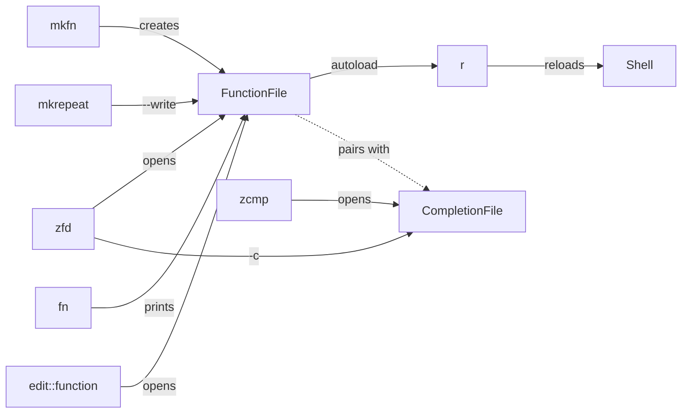

**Related:** [Zsh](../../areas/zsh.md) · [Startup](startup.md)

These functions create, load, reload, edit and inspect the autoloaded functions and completions under `zsh/.config/zsh/functions` and `completions`, and provide the logging and lookup helpers (`log::info`, `log::error`, `has`) that most other functions call. The two `AGENTS.md` files in those directories hold the rules a new function must meet.

## How it works

Every file in `functions/` is a bare function body marked `#autoload`. `zsh/.config/zsh/.zprofile` puts `functions` and `completions` on `fpath` and autoloads each non-`.md`, non-zwc file in `functions/` (`zsh/.config/zsh/.zprofile:39-40`). Every function has a same-named completion file, so adding a function means adding two files.

## Function and completion pairing

`zsh/.config/zsh/functions/AGENTS.md` requires a completion for every function. The completion is `completions/_<name>`, starts with `#compdef <name>`, ends with the vim modeline used by the other completion files, and covers every option the function parses with `zparseopts`. It is added or changed in the same commit as the function (`zsh/.config/zsh/functions/AGENTS.md:1-9`). A function with no arguments completes only `-h` and `--help`. Internal helpers are exempt and are listed in that file; `wezterm::_pane` is the one named (`zsh/.config/zsh/functions/AGENTS.md:10`). `_sys-report` and `_mkrepeat` are the stated templates (`zsh/.config/zsh/functions/AGENTS.md:8`). Three no-argument functions deviate from the `-h`/`--help` rule: `_rld::file`, `_help-zshglob` and `_ls-fpath` only call `_message 'no arguments'` (`zsh/.config/zsh/completions/_rld::file:3`). `_F` simply calls `_fn`, and `_output-to-array` completes names of writable array parameters (`zsh/.config/zsh/completions/_output-to-array`).

`zsh/.config/zsh/completions/AGENTS.md` is a general guide to writing zsh completions: `_arguments` syntax, state-based and nested-subcommand completion, and the `_store_cache` API. It states that nested `_arguments` calls need `-C` and that the subcommand is read from `line[1]`, not `$words[2]` (`zsh/.config/zsh/completions/AGENTS.md`). The completions in this component are mostly short `_arguments` specs. `_mkrepeat` forwards the trailing words to `_normal` so the wrapped command completes (`zsh/.config/zsh/completions/_mkrepeat:11`). `_zfd` lists function or completion names from disk depending on `-c` (`zsh/.config/zsh/completions/_zfd:13-24`).

`zsh/.config/zsh/functions/AGENTS.md` also says to rebuild the compiled-function digest after adding or deleting a function (`zsh/.config/zsh/functions/AGENTS.md:11`), and the root `AGENTS.md` adds that a stale digest keeps serving a deleted function. No file in the repository builds the compiled-function digest; files with the zwc extension are gitignored (`.gitignore:11`) and the autoload globs skip them (`zsh/.config/zsh/.zprofile:40`, `zsh/.config/zsh/functions/r:29`). How the digest is created is not determined from the code. `r` does not touch it. `zsh-clean` deletes compiled-digest files (extension zwc) below `$ZDOTDIR` (`zsh/.config/zsh/functions/zsh-clean:33`).

## Creating functions

`mkfn NAME` writes a skeleton file to `$ZDOTDIR/functions/NAME`: `#autoload`, the modeline, `emulate -L zsh`, `zparseopts` for `-h` and `-d`, and a usage block (`zsh/.config/zsh/functions/mkfn:43-67`). It refuses an existing file (`zsh/.config/zsh/functions/mkfn:38-41`). `--edit` opens the result in `$EDITOR` (`zsh/.config/zsh/functions/mkfn:71`). It does not create the completion file, so the pairing rule is left to the author.

`mkrepeat NAME COMMAND...` defines a function that runs the command and then pushes `NAME ` onto the next prompt with `print -z` (`zsh/.config/zsh/functions/mkrepeat:37`). It appends `"$@"` to the command unless the command already mentions `$1`, `$@`, `$*` or `$argv` (`zsh/.config/zsh/functions/mkrepeat:36`). The body is parsed under a scratch name first because zsh accepts a syntactically broken body without failing (`zsh/.config/zsh/functions/mkrepeat:57-64`). The function is defined with `functions[$name]=$body` and recorded in the global `_mkrepeat_names`, which lets a later call replace it without `--force` (`zsh/.config/zsh/functions/mkrepeat:45-67`). An existing command with the same name blocks the call unless `-f` is given (`zsh/.config/zsh/functions/mkrepeat:47-50`). `--write` also saves a file in `functions/` (`zsh/.config/zsh/functions/mkrepeat:71-82`). Its header comment says to call it from the rc.d directory; no the rc.d directory file at this commit does.

`gen-ghr-test` prints a bats test case for each GitHub project passed to it, using `gh search repos` for the description (`zsh/.config/zsh/functions/gen-ghr-test:24-35`). It only prints; nothing is written.

## Loading and reloading

`r` reloads every autoloadable function: it unfunctions each name found in `functions/` (excluding `.md` and zwc) and runs `autoload -Uz` on them again, with `-T` for tracing when `--trace` is set (`zsh/.config/zsh/functions/r:29-34`). The glob uses `(N.:t)`, so only plain files count, and `--debug` turns on xtrace with a custom `PS4` (`zsh/.config/zsh/functions/r:23-27`). The last commit touching it made it skip non-functions (`550e5a4`).

`zsh::rld` validates the dotfiles by running `zsh -ilc exit` in a subshell with output captured, aborting if the exit status is non-zero or any output appears (`zsh/.config/zsh/functions/zsh::rld:33-45`). On success it runs `exec zsh -l`, or stops after validation with `--dry-run` (`zsh/.config/zsh/functions/zsh::rld:47-52`). `--no-zinit` sets `NO_ZINIT=1` for both runs; `zsh/.config/zsh/rc.d/05-zinit.zsh` reads that variable and skips zinit (`zsh/.config/zsh/rc.d/05-zinit.zsh:8`).

`rld::file` lists every file under `$DOTFILES` (default `~/.config/dotfiles`), picks one with fzf and sources it (`zsh/.config/zsh/functions/rld::file:9-20`).

`load-comp TOOL` loads a tool's own zsh completion. It tries a fixed list of subcommand forms (`completion zsh`, `completions zsh`, `--generate-completion zsh` and others), or the single form from `--command` (`zsh/.config/zsh/functions/load-comp:43-61`). It captures each form's output first and accepts only text that starts with `#compdef` or contains a `compdef _` line, because some tools print a bash script and still exit 0 (`zsh/.config/zsh/functions/load-comp:65-70`). A `#compdef` script is installed as `_TOOL` and bound with `compdef`; any other zsh script is `eval`ed (`zsh/.config/zsh/functions/load-comp:84-90`). If no form works, it falls back to `_gnu_generic`, which parses `--help` (`zsh/.config/zsh/functions/load-comp:77-82`). It requires `compdef` to be loaded already (`zsh/.config/zsh/functions/load-comp:72-75`).

`zsh::fix-insecure-dirs` runs `chmod g-w` on every directory `compaudit` reports. It autoloads `compaudit` first because compinit is loaded lazily (`zsh/.config/zsh/functions/zsh::fix-insecure-dirs:23-32`).

## Inspecting and editing

`fn NAME...` prints a function's definition with `functions -x N` (default indent 4), forcing a load first with `autoload +X` so an autoload stub is replaced by the body (`zsh/.config/zsh/functions/fn:54-56`). `--copy` asks for confirmation per function and pipes to `pbcopy` (`zsh/.config/zsh/functions/fn:64-69`). `F` is a wrapper that sets `_fn_command` so `fn` names `F` in its messages (`zsh/.config/zsh/functions/F:9-11`, `zsh/.config/zsh/functions/fn:21`).

`edit::function NAME` opens the file an autoloaded function came from, using `$functions_source` after forcing the load (`zsh/.config/zsh/functions/edit::function:18-27`). `zfd` edits function files by name, or completion files with `-c`, in a split editor (`-O`); with no arguments it `cd`s to `functions/` (`zsh/.config/zsh/functions/zfd:32-41`). `zcmp` does the same for completions and adds the leading underscore when missing (`zsh/.config/zsh/functions/zcmp:27`). `zdd [PATH]` opens a path below `$ZDOTDIR`: files are edited, directories are entered and listed with `eza` or `ls -A` (`zsh/.config/zsh/functions/zdd:25-33`). `zgd` changes into `~/.local/share/zinit/zinit.git/$1` (`zsh/.config/zsh/functions/zgd:8`).

`list::functions FILE` prints the sorted names of `name() {` definitions in a file, matching with a glob on each line (`zsh/.config/zsh/functions/list::functions:26-34`). `ls-fpath` calls `ls-path --fpath`; `ls-path` belongs to [everyday utilities](everyday-utilities.md) (`zsh/.config/zsh/functions/ls-fpath:8`). `help-zshglob` prints a table of glob qualifiers (`zsh/.config/zsh/functions/help-zshglob:7`).

`zsh-clean` deletes `*.zcomp*`, `*.zsh_sessions` and compiled-digest files (extension zwc) below `$ZDOTDIR`, with `--dryrun` to list them first (`zsh/.config/zsh/functions/zsh-clean:33-44`). `zsh-xtrace` runs `zsh --norcs -lxvc` and pipes through `ts` and `ansifilter` into zsh_start.log in the current directory; it needs both commands (`zsh/.config/zsh/functions/zsh-xtrace:25-34`).

## Shared helpers

`log::info` prints `==> message`. On a terminal it expands prompt escapes with `print -P`; otherwise it strips `%F{}`, `%B` and similar markup and prints plain text (`zsh/.config/zsh/functions/log::info:13-20`). Callers pass escapes on purpose, for example `%B...%b` in `zsh/.config/zsh/rc.d/05-zinit.zsh:25`. `log::error` writes `Error: message` to stderr, coloring only the prefix when stderr is a terminal, so a `%` in the message is safe (`zsh/.config/zsh/functions/log::error:11-15`). Both test whether the output file descriptor is a terminal; neither checks for an interactive shell.

`has NAME` returns true if `whence` finds the name as command, function, builtin or alias (`zsh/.config/zsh/functions/has:8-10`). `output-to-array [NAME]` reads stdin into an array named `NAME` (default `lines`), validating the name and refusing a terminal on stdin; its locals carry an `_o2a_` prefix to avoid colliding with the caller's name (`zsh/.config/zsh/functions/output-to-array:29-46`).

## Where to look

- `zsh/.config/zsh/functions/AGENTS.md`: the pairing and helper-exemption rules.
- `zsh/.config/zsh/completions/AGENTS.md`: how to write a completion.
- `zsh/.config/zsh/functions/mkfn` and `mkrepeat`: skeleton and generator.
- `zsh/.config/zsh/functions/r` and `zsh::rld`: reload paths.
- `zsh/.config/zsh/functions/log::info` and `log::error`: output helpers used across the functions.
- `zsh/.config/zsh/.zprofile`: where `fpath` and autoloading are set up.
