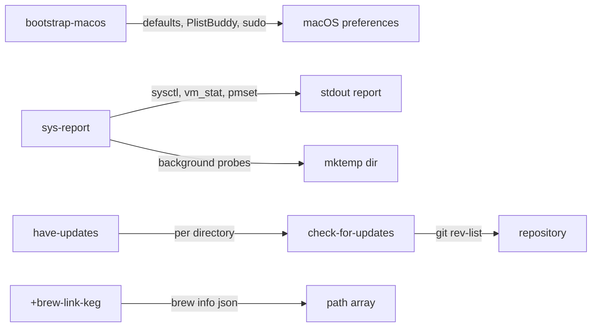

**Related:** [Zsh](../../areas/zsh.md) · [Function tooling](function-tooling.md) · [Startup](startup.md)

Seven autoloaded functions that configure or inspect the machine. `bootstrap-macos` writes macOS preferences in named sections. `sys-report` prints a coloured health report with a warning summary. `+brew-link-keg` puts keg-only Homebrew formulae and GNU tool directories on `path`. `check-for-updates` and `have-updates` report git repositories that are behind their upstream. `macos::rm-ds-store` and `safari::tab` are short macOS helpers. Each function has a completion file of the same name with a `_` prefix, as `zsh/.config/zsh/functions/AGENTS.md` requires. The repo-level installer only mentions `bootstrap-macos` in its closing hints (`install.zsh:302`); nothing in rc.d calls any of these functions.

## How it works

All seven are files without a function wrapper, loaded by `autoload`. Each begins with `emulate -L zsh`, so options set inside do not leak into the caller (`zsh/.config/zsh/functions/sys-report:6`, `zsh/.config/zsh/functions/+brew-link-keg:9`). The three with options parse them with `zparseopts` from `zsh/zutil` (`zsh/.config/zsh/functions/bootstrap-macos:44-49`, `zsh/.config/zsh/functions/sys-report:11`, `zsh/.config/zsh/functions/+brew-link-keg:14`). Failures go through `log::error`, and `bootstrap-macos` also uses `log::info`; both helpers live in [Function tooling](function-tooling.md).

## bootstrap-macos

The function applies about 22 preference sections to one machine. It targets macOS 26 and lists the keys it chose to skip as dead there (`zsh/.config/zsh/functions/bootstrap-macos:6-17`). Usage: `bootstrap-macos [-d] [-h] [-n] [-o <section>[,<section>...]]` (`zsh/.config/zsh/functions/bootstrap-macos:30`).

### Argument handling

- Any leftover operand is an error that suggests `--only <operand>`. Without the check, `bootstrap-macos dock` would apply every section, because `zparseopts -F` leaves operands in `$@` (`zsh/.config/zsh/functions/bootstrap-macos:51-57`).
- `-o` uses the `+:=` form so it can repeat. Each value is split on commas and a leading `=` is stripped (`zsh/.config/zsh/functions/bootstrap-macos:77-85`).
- `--only ''` or `--only ,` fails with a list of valid sections. The test is on the number of `-o` occurrences, not the number of parsed names, so an empty selection cannot mean "all" (`zsh/.config/zsh/functions/bootstrap-macos:86-92`).
- Each requested name is checked against the `sections` array, and valid names set keys of the `do_section` associative array. With no `-o`, every section is set (`zsh/.config/zsh/functions/bootstrap-macos:93-104`). Each section block later tests `${+do_section[name]}`.

### Dry run and failures

`$run` is an empty array on a real run and `builtin print -r --` under `--dry-run`, so any command written as `$run cmd args` is either executed or printed (`zsh/.config/zsh/functions/bootstrap-macos:67-71`). The comment gives the reason: no helper functions, which would stay defined after an autoloaded function returns. Commands that cannot take the prefix have explicit dry-run branches: the PAM file write (`zsh/.config/zsh/functions/bootstrap-macos:176-179`), the Terminal profile import (`zsh/.config/zsh/functions/bootstrap-macos:297-299`), the wallpaper write (`zsh/.config/zsh/functions/bootstrap-macos:370-371`), the `cfprefsd` restart (`zsh/.config/zsh/functions/bootstrap-macos:583`) and the final app restarts (`zsh/.config/zsh/functions/bootstrap-macos:817-818`). The hardware UUID lookup (`ioreg`) still runs in a dry run (`zsh/.config/zsh/functions/bootstrap-macos:113`).

`failures` counts steps that failed but did not stop the run (`zsh/.config/zsh/functions/bootstrap-macos:75`). It is incremented by missing tools or files and by failed `sudo`/`systemsetup` calls. At the end a non-zero count logs the total and returns 1 (`zsh/.config/zsh/functions/bootstrap-macos:829-833`). Plain `defaults write` lines are not checked individually.

### Preamble

Before any section, the function quits System Settings so an open pane cannot overwrite the new values (`zsh/.config/zsh/functions/bootstrap-macos:106-108`). It reads `IOPlatformUUID` with `ioreg` and builds the ByHost plist path `~/Library/Preferences/ByHost/.GlobalPreferences.<uuid>.plist`; an empty UUID returns 1 (`zsh/.config/zsh/functions/bootstrap-macos:112-118`). It runs `sudo -v` once, and only when a selected section is one of sound, privacy, appearance, update, touchid or datetime. `--dry-run` skips it (`zsh/.config/zsh/functions/bootstrap-macos:130-133`).

### Section order

The `sections` array (`zsh/.config/zsh/functions/bootstrap-macos:23-28`) fixes the names accepted by `-o`. The execution order in the file differs: `touchid` runs first (`zsh/.config/zsh/functions/bootstrap-macos:148`), then dock (191), hotcorners (222), dockitems (242), menubar (313), datetime (329), tiling (350), wallpaper (366), appearance (475), sound (493), keyboard (521), text (550), cursor (567), pointer (589), finder (625), anim (713), dialogs (726), screenshots (740), privacy (754), screenlock (775), update (783) and misc (796). Each is an `if ((${+do_section[x]}))` block that logs its name with `log::info`. Most blocks are plain `$run defaults write` lines, so adding a preference is adding a line to the right block. The sections with logic beyond that are described next.

### Sections with their own mechanism

- **touchid.** Reads `/etc/pam.d/sudo_local.template`, drops its `pam_tid` lines, appends `auth optional <pam_reattach.so>` when the Homebrew `pam-reattach` module exists, then appends `auth sufficient pam_tid.so`, and writes the result to `/etc/pam.d/sudo_local` through `sudo tee`. It compares the existing file against the desired state first and skips the write when both match. The flags are `optional` and `sufficient` so a bad module cannot lock out sudo; `pam_reattach` is needed for Touch ID inside tmux (`zsh/.config/zsh/functions/bootstrap-macos:138-186`).
- **dockitems.** Needs `dockutil`; without it the section logs an error and counts a failure (`zsh/.config/zsh/functions/bootstrap-macos:244-246`). It indexes installed `.app` bundles by name from `/Applications` and `/System/Applications`, first match wins (`zsh/.config/zsh/functions/bootstrap-macos:250-256`), removes all Dock items, adds Downloads, then adds a fixed list of apps, using WezTerm in place of Terminal when WezTerm is installed (`zsh/.config/zsh/functions/bootstrap-macos:257-274`). Independently of `dockutil`, it installs the Terminal profile darwin.terminal (first under `$XDG_CONFIG_HOME/macos`, then under `$DOTFILES/macos/.config/macos`), reads its `:name` with PlistBuddy and writes it with `defaults write ... -dict-add` as the default and startup profile (`zsh/.config/zsh/functions/bootstrap-macos:279-306`).
- **datetime.** Calls `systemsetup` for network time, the time server and the `America/Chicago` zone under `sudo`, filtering the harmless `Error:-99` line from stderr while keeping the exit status (`zsh/.config/zsh/functions/bootstrap-macos:331-341`).
- **wallpaper.** Kills `WallpaperAgent` with SIGKILL, writes a solid-black Index.plist into `~/Library/Application Support/com.apple.wallpaper/Store` from a heredoc, converts it to binary, kills the agent again and polls up to 5 s for `pgrep` to find the respawned process (`zsh/.config/zsh/functions/bootstrap-macos:373-461`). It then checks that `plutil -p` still shows com.apple.wallpaper.choice.color. If the agent rewrote the file, the section counts a failure and falls back to setting `Solid Colors/Black.png` through System Events (`zsh/.config/zsh/functions/bootstrap-macos:462-468`).
- **keyboard, cursor, finder views.** `defaults write` cannot write typed nested values here, so PlistBuddy edits plists directly: delete the key (ignoring failure), then add it. Caps Lock to Escape is written into the ByHost plist as integers 30064771129 and 30064771113 (`zsh/.config/zsh/functions/bootstrap-macos:532-544`). Cursor fill and outline are written to com.apple.universalaccess.plist, followed by `killall cfprefsd` (`zsh/.config/zsh/functions/bootstrap-macos:567-584`). Finder column view options are written under both `StandardViewOptions` and `FK_StandardViewOptions2` (`zsh/.config/zsh/functions/bootstrap-macos:682-703`).
- **sound.** Uses `nvram StartupMute=%01` on arm64 and `SystemAudioVolume=%00` otherwise (`zsh/.config/zsh/functions/bootstrap-macos:499-503`).
- **screenlock.** Uses `sysadminctl -screenLock 5 -password -`, which prompts for a password separately from the earlier `sudo -v` (`zsh/.config/zsh/functions/bootstrap-macos:772-777`).
- **finder.** Ends by pointing at `macos::rm-ds-store` for clearing view state; the function does not call it (`zsh/.config/zsh/functions/bootstrap-macos:680-681`).

### Apply step

After the sections, and regardless of which ran, the function restarts Dock, Finder, SystemUIServer, ControlCenter, WindowManager, Terminal and `cfprefsd` with `killall`, then logs that some changes need a logout or restart. One array feeds both the real run and the dry-run print (`zsh/.config/zsh/functions/bootstrap-macos:805-825`).

### Completion drift

`_bootstrap-macos` keeps its own section list with descriptions (`zsh/.config/zsh/completions/_bootstrap-macos:9-31`). It has 21 entries and no `datetime`, which the function accepts (`zsh/.config/zsh/functions/bootstrap-macos:24`). `--only` is repeatable and comma-aware in completion: `compset -P '*,'` strips everything through the last comma before `_describe` (`zsh/.config/zsh/completions/_bootstrap-macos:42-46`).

## sys-report

`sys-report [-c] [-n] [-d] [-p] [-s]` prints sections to stdout and ends with a summary of warnings. It returns 1 on non-macOS (`zsh/.config/zsh/functions/sys-report:25`). Its exit status does not depend on the warnings: the last statement is a `print` (`zsh/.config/zsh/functions/sys-report:491-497`).

### Colour and helper scope

Colour is on when `--color` is given, or when stdout is a terminal and `NO_COLOR` is empty; `--no-color` overrides both (`zsh/.config/zsh/functions/sys-report:30-34`). Colour codes sit in `c_*` locals and are empty strings when off, so every print path is the same.

Helpers are defined as `_sr_*` functions inside the function body, so they share its locals (`zsh/.config/zsh/functions/sys-report:49-143`). An `EXIT` trap runs `unfunction -m '_sr_*'` and removes the temp directory; `$tmp` is expanded when the trap is set because locals are gone when it runs (`zsh/.config/zsh/functions/sys-report:45-47`). The helpers return values in `REPLY` or in the `lvlcol` local. Main ones:

- `_sr_lvl` and `_sr_lvl_lo` map a number to green, yellow or red given two thresholds, for higher-is-worse and lower-is-worse values (`zsh/.config/zsh/functions/sys-report:53-66`).
- `_sr_bar` draws a 20-cell usage bar coloured with warn at 75 and bad at 90 (`zsh/.config/zsh/functions/sys-report:69-76`).
- `_sr_sp` and `_sr_vm` parse `system_profiler` "Key: value" text and `vm_stat` page counts into the `sp` and `vmp` associative arrays with a zsh pattern match (`zsh/.config/zsh/functions/sys-report:101-119`).
- `_sr_bg` and `_sr_get` run slow commands in the background and wait for them (below).

### Background probes

`_sr_bg name cmd...` runs the command detached (`&|`), writes stdout to `$tmp/name`, and creates `$tmp/name.done` when finished, whether or not the command succeeded (`zsh/.config/zsh/functions/sys-report:88-92`). `_sr_get name` loops on `zselect -t 2` until the marker exists, then reads the file into `REPLY` (`zsh/.config/zsh/functions/sys-report:95-98`). The probes are `du -sk` on five directories (Downloads, Caches, Trash, Logs, Developer) and, if `brew` exists, `brew outdated --quiet` and `du -sk` of the Homebrew cache (`zsh/.config/zsh/functions/sys-report:256-264`). They start after the TOP CPU and TOP MEM listings so they do not appear in them (`zsh/.config/zsh/functions/sys-report:255`), and are read back in the STORAGE HOTSPOTS and PACKAGES sections. With `--procs`, `iostat` and `top -l 2` also start in the background (`zsh/.config/zsh/functions/sys-report:382-383`).

### Sections and warning thresholds

Sections print in this order. A warning is added to `warns` where a threshold is crossed.

| Section | Source | Warning when |
|---|---|---|
| SYSTEM | `sw_vers`, `sysctl kern.boottime`, vm.loadavg (`zsh/.config/zsh/functions/sys-report:149-172`) | uptime at least 30 days; 1-minute load at least the core count |
| HARDWARE | `system_profiler SPHardwareDataType` (`zsh/.config/zsh/functions/sys-report:177-183`) | none |
| DISK | `df -k` on `/System/Volumes/Data`, `diskutil info /` SMART (`zsh/.config/zsh/functions/sys-report:187-206`) | at least 90% used; SMART status other than Verified or a "Support" text (for example "Not Supported") |
| MEMORY | `vm_stat`, hw.memsize, kern.memorystatus_level, vm.swapusage (`zsh/.config/zsh/functions/sys-report:212-249`) | pressure level at most 15% free; swap use at least 4096 MB |
| TOP CPU, TOP MEM | `ps` sorted by CPU or memory, five rows (`zsh/.config/zsh/functions/sys-report:121-131`) | none |
| BATTERY | `pmset -g batt`, `system_profiler SPPowerDataType` (`zsh/.config/zsh/functions/sys-report:269-301`) | capacity at most 80%; 1000 cycles or more; condition not Normal |
| THERMAL | `pmset -g therm` (`zsh/.config/zsh/functions/sys-report:306-317`) | thermal warning recorded; `CPU_Speed_Limit` below 100 |
| STARTUP | count of user LaunchAgents plists, `launchctl list` count (`zsh/.config/zsh/functions/sys-report:321-326`) | none |
| STORAGE HOTSPOTS | the five `du` results, sorted descending (`zsh/.config/zsh/functions/sys-report:331-343`) | none (colour only, 5 GiB and 20 GiB) |
| PACKAGES | `brew outdated`, cache size (`zsh/.config/zsh/functions/sys-report:347-362`) | 20 or more outdated |
| CRASH REPORTS | `~/Library/Logs/DiagnosticReports`, files modified in 7 days (`zsh/.config/zsh/functions/sys-report:366-374`) | 5 or more this week |

Memory used is computed as active plus wired plus compressor pages times the page size read from the first `vm_stat` line (`zsh/.config/zsh/functions/sys-report:213-220`). Battery sections print "none" when `pmset` shows no `InternalBattery` (`zsh/.config/zsh/functions/sys-report:299-301`).

### Optional deep dives

`--procs` adds process states from `ps` (a zombie adds a warning), the five processes with most threads from `ps -M`, processes in U or D state (any adds a warning), `iostat` rows and the second sample of `top -l 2` (`zsh/.config/zsh/functions/sys-report:377-428`).

`--startup` adds login items through `osascript` against System Events, with an "allow Automation" message if that fails (`zsh/.config/zsh/functions/sys-report:437-443`); plist labels in the three LaunchAgents and LaunchDaemons directories, 15 per directory (`zsh/.config/zsh/functions/sys-report:134-147` and `445-447`); background items parsed from `sfltool dumpbtm` by an inline awk script, with Apple items filtered and 20 rows shown (`zsh/.config/zsh/functions/sys-report:450-475`); and non-Apple entries of `launchctl list` (`zsh/.config/zsh/functions/sys-report:480-488`). These two deep dives add no warnings except the process ones above.

### Summary

SUMMARY prints each entry of `warns` after a red `!`, or "all clear" (`zsh/.config/zsh/functions/sys-report:492-497`). To add a check, print a `_sr_kv` row in the matching section and append to `warns` at the threshold.

## +brew-link-keg

Prepends keg-only formula `bin` directories and GNU `gnubin` directories to `path`. It needs `brew` and `jq` (`zsh/.config/zsh/functions/+brew-link-keg:31-32`). Patterns are the positional arguments; with `-a` or no arguments the pattern is `*` (`zsh/.config/zsh/functions/+brew-link-keg:34-35`). `-a` therefore behaves the same as no arguments.

1. Keg-only names come from `brew info --installed --json=v1` filtered by `jq` on `.keg_only == true` (`zsh/.config/zsh/functions/+brew-link-keg:41-42`). The names matching any pattern (`*pat*` glob) are sorted, deduplicated, and `$prefix/opt/<keg>/bin` is prepended for each; `prefix` is two directories above the `brew` binary (`zsh/.config/zsh/functions/+brew-link-keg:37`, `zsh/.config/zsh/functions/+brew-link-keg:46-53`).
2. GNU tool directories are found by globbing `*/libexec/gnubin` under `/opt/homebrew/opt` and `/usr/local/opt`. Patterns match against the whole path, and each match is prepended (`zsh/.config/zsh/functions/+brew-link-keg:55-67`).

It does not check that the `bin` directory exists. The header relies on `path` being declared unique (`typeset -U`) in `.zprofile`, so repeated calls do not duplicate entries (`zsh/.config/zsh/functions/+brew-link-keg:4-7`, `zsh/.config/zsh/.zprofile:19`). Despite the `-a` help text ("all unlinked kegs"), the code selects keg-only formulae and does not test whether a keg is linked (`zsh/.config/zsh/functions/+brew-link-keg:23`).

## Repository update checks

`check-for-updates [dir]` defaults to `$PWD`. It runs one `git -C <dir> rev-list --left-right --count HEAD...@{u}`. On success it prints "Update available" and returns 0 when the second count (commits only upstream) is above 0, otherwise "No update available" and returns 1 (`zsh/.config/zsh/functions/check-for-updates:12-33`). When the git call fails, a second `rev-parse` decides between "not a git repository" (logged) and "No upstream configured", both returning 2 (`zsh/.config/zsh/functions/check-for-updates:18-25`). No `git fetch` is run, so the answer reflects the last fetched upstream ref. The function parses no options (`zsh/.config/zsh/completions/_check-for-updates:4-5` offers only a directory).

`have-updates [dir]` defaults to `.`, rejects more than one argument or a non-directory (`zsh/.config/zsh/functions/have-updates:21-31`), calls `check-for-updates` on each immediate subdirectory, and treats exit 0 as "behind" (`zsh/.config/zsh/functions/have-updates:36-38`). It prints `N updates:` followed by one directory name per line (`zsh/.config/zsh/functions/have-updates:40-41`). `-h` is handled (`zsh/.config/zsh/functions/have-updates:16-19`).

## Small macOS helpers

- `macos::rm-ds-store` runs `find $HOME` pruning `~/.Trash` and `~/Library`, then prints and deletes every `.DS_Store` (`zsh/.config/zsh/functions/macos::rm-ds-store:9-16`). It takes no arguments and asks for no confirmation.
- `safari::tab` runs `osascript` to activate Safari and click File > New Tab through System Events (`zsh/.config/zsh/functions/safari::tab:8-13`). Whether it needs a particular privacy permission is not determined from the code.
- Their completions only print "no arguments" (`zsh/.config/zsh/completions/_macos::rm-ds-store:4`, `zsh/.config/zsh/completions/_safari::tab:4`).

## Where to look

- `zsh/.config/zsh/functions/bootstrap-macos`: the section blocks; start at the `sections` array (line 23) and the `do_section` setup (lines 79-104).
- `zsh/.config/zsh/completions/_bootstrap-macos`: section list for `--only`; keep it equal to the function's array.
- `zsh/.config/zsh/functions/sys-report`: helpers at the top (lines 49-143), probes at 255-264, sections below.
- `zsh/.config/zsh/functions/+brew-link-keg`: keg selection (41-53) and GNU path logic (55-67).
- `zsh/.config/zsh/functions/check-for-updates` and `zsh/.config/zsh/functions/have-updates`: exit-code contract and the loop that consumes it.
