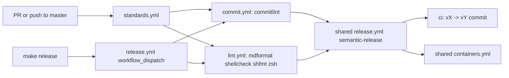

**Related:** [Bootstrap and Install](../areas/bootstrap.md) · [Zsh](../areas/zsh.md) · [Desktop](../areas/desktop.md) · [CLI tools](../areas/cli-tools.md) · [Style](style.md)

The repository is a set of GNU Stow packages that target macOS and Linux on x86_64 and ARM64 (`README.md:9`). Zsh is the main language, installed through Homebrew and loaded by zinit. CI, releases and Dependabot are configured in this repository but delegate their work to shared workflows in vladdoster/.github. This page lists the technologies and what each is for, then describes the release and CI pipeline and the two Dockerfiles.

## Technologies

| Technology | Used for | Where |
|---|---|---|
| GNU Stow | Symlinks each top-level directory into `$HOME`, one package at a time | `Makefile:13`, `Makefile:39-41` |
| Zsh | Shell, installer, functions, completions, CI tests | [Zsh](../areas/zsh.md) |
| zinit | Plugin manager. rc.d/05-zinit.zsh clones it to `~/.local/share/zinit` on first start and compiles it | `zsh/.config/zsh/rc.d/05-zinit.zsh:12`, `:23-34` |
| Homebrew | Package manager on macOS and Linux. `Brewfile` lists formulae, casks and `uv` packages | `Brewfile`, [Bootstrap](../areas/bootstrap.md) |
| GNU Make | Entry point for install, brew sync, Docker and release targets. `SHELL` is zsh with `pipefail` | `Makefile:3-5` |
| Neovim | Editor. The Brewfile builds it from `HEAD`; the Ubuntu image builds it from source | `Brewfile:36`, `Dockerfile:62-66` |
| WezTerm | Terminal emulator, configured in Lua. The Brewfile installs the nightly cask | `Brewfile:64`, `wezterm/.config/wezterm/wezterm.lua`, [Desktop](../areas/desktop.md) |
| tmux | Terminal multiplexer | `Brewfile:49`, [Desktop](../areas/desktop.md) |
| Docker | Test container for the dotfiles and a published image | [Docker images](#two-dockerfiles) |
| GitHub Actions | Install regression tests, commit and code linting, releases, run cleanup | `.github/workflows/` |
| semantic-release | Computes the next version from commit messages and writes `VERSION` and `CHANGELOG.md` | vladdoster/.github .releaserc.json |
| Dependabot | Weekly update PRs for Docker base images and GitHub Actions | `.github/dependabot.yml` |

Kitty, yabai and skhd configuration also exists; the [Desktop](../areas/desktop.md) doc covers them. Git, ripgrep, curl, pip and vim settings are in [CLI tools](../areas/cli-tools.md). The Brewfile has no entries for kitty, yabai or skhd (`grep` of `Brewfile` found none).

## Version constraints

- `install.zsh` requires zsh 5.8 or later because it uses `zparseopts -F` (`install.zsh:59`).
- `Brewfile` installs `node@24` with `link: :overwrite` and plain `node` unlinked (`Brewfile:39-41`).
- `cargo-update` comes from a bottle. The Brewfile comment records that `cargo install --locked cargo-update` fails against Homebrew's OpenSSL 4 (`Brewfile:8-9`).
- `Dockerfile` uses `ubuntu:latest` and the Arch image uses `archlinux:base-devel`, so neither pins a base version (`Dockerfile:3`, `arch-linux.Dockerfile:1`). Dependabot's `docker` ecosystem watches `/` (`.github/dependabot.yml:4-10`).
- `VERSION` holds a bare semantic version, currently 4.70.0 (`VERSION:1`).
- The shared lint workflow runs on ubuntu-26.04 and `actions/checkout@v7`; the install workflow's test matrix is `macos-latest` and `ubuntu-latest` (`.github/workflows/install.yml:36-41`).

## Release and CI pipeline

### Callers in this repository

All three workflows here contain only `uses:` calls to a workflow in the vladdoster/.github repository at master. The logic lives in that other repository.

- standards.yml runs on pushes and pull requests to `master` and on manual dispatch. It calls commit.yml and lint.yml (`.github/workflows/standards.yml:3-19`).
- release.yml runs only on `workflow_dispatch`. It calls commit.yml and lint.yml, then the shared release.yml with `needs: [commit, lint]`, then the shared containers.yml with `needs: [release]` (`.github/workflows/release.yml:3-24`). `make release` starts it with `gh workflow run` with the release workflow on master (`Makefile:123-125`).
- cleanup-runs.yml runs every Sunday at 00:00 UTC and on dispatch, and calls the shared cleanup.yml (`.github/workflows/cleanup-runs.yml:3-14`).
- install.yml is a fourth workflow that tests the installer. [Bootstrap](../areas/bootstrap.md) owns it.

### What the shared workflows do

These facts come from the `master` branch of vladdoster/.github read through the GitHub API on 2026-11-07. They can change without a commit here.

- commit.yml runs `commitlint` from the `ghcr.io/vladdoster/commitlint:latest` image against the pull request's commits, or the pushed range.
- lint.yml runs the `ghcr.io/vladdoster/lint:latest` image with `mdformat --check --wrap 120` on every `*.md` except `CHANGELOG.md`, `shfmt` and `shellcheck` on `*.sh`, and `zsh -n` plus `zcompile` on every `*.zsh`. Each step skips when no matching file exists.
- release.yml runs `semantic-release` on Node 20. It installs the changelog, git, exec and docker plugins and a replace plugin at run time, downloads .releaserc.json from the vladdoster/.github master branch, and commits as Vladislav Doster.
- containers.yml builds `Dockerfile` from the repository root with buildx for `linux/amd64` and `linux/arm64` and pushes to `ghcr.io/vladdoster/dotfiles` with branch, PR and semver tags. It does not push on pull requests.
- cleanup.yml deletes workflow runs older than zero days while keeping the latest five.

### How VERSION and CHANGELOG.md change

Nothing here edits `VERSION` or `CHANGELOG.md` by hand. The shared .releaserc.json runs these plugins in order: commit analysis, a replace plugin that rewrites `VERSION` to the next version, release notes, the changelog plugin that prepends to `CHANGELOG.md`, the git plugin, and GitHub release creation. The git plugin commits only `CHANGELOG.md` and `VERSION` with the message `ci: v${lastRelease.version} → v${nextRelease.version}` followed by the release notes. `git log` shows the result, for example `5c4b7bf ci: v4.69.0 → v4.70.0`, which touches exactly those two files.

The commit analyzer reads Conventional Commit types from the commits since the last tag, so `feat` produces a minor bump, `fix` a patch bump, and a breaking change a major bump (default preset behaviour; the preset is not set in .releaserc.json). commit.yml enforces that the messages follow the format. `CHANGELOG.md` is generated output and is excluded from these docs. Do not edit it or `VERSION` in a feature change.

### Dependabot and the digest

`.github/dependabot.yml` opens weekly pull requests, Sundays at 16:00, for the `docker` ecosystem and for `github-actions`, with commit prefixes `build` and `ci` plus scope. Actions updates are grouped into one pull request (`.github/dependabot.yml:1-24`). The prefixes match what commit.yml accepts for Conventional Commits; the commitlint configuration is in the image and was not inspected.

`.github/weekly-digest.yml` configures the Weekly Digest GitHub app: publish on Sunday, with issues, pull requests, contributors, stargazers and commits all enabled (`.github/weekly-digest.yml:1-6`). Nothing in the repository reads it.

## Two Dockerfiles

`Dockerfile` is the main image. It is the only one the release pipeline builds, because the shared containers.yml uses the default `Dockerfile` in the repository root. The [Bootstrap](../areas/bootstrap.md) doc says no workflow references either file; that is true of the files in this repository, but the shared workflow called by release.yml builds the root `Dockerfile`. It starts from `ubuntu:latest`, installs packages with apt, and copies the working tree into `~/.config/dotfiles` (`Dockerfile:3`, `Dockerfile:68`). Local `make docker-build` and `docker/Makefile` also use it.

`arch-linux.Dockerfile` is the same setup on `archlinux:base-devel`, with `yay` for AUR packages. It clones the dotfiles from GitHub instead of copying the build context, so it tests what is on `master` and not the local tree (`arch-linux.Dockerfile:89-90`, `:94-95`). It was added later as a second distribution to test against (`git log` entry `9c0ea2a feat: add dockerfile with arch linux base image`). No workflow, Makefile target or Dependabot entry references it, and it lags the Ubuntu file: it still installs `exa` and has its neovim build and `COPY` lines commented out (`arch-linux.Dockerfile:62`, `:82-87`). Treat it as manual. Why it exists beyond being a second distribution is not determined from the code.

Build mechanics, the multi-arch `docker/Makefile` and `docker/init-buildx.sh` are in [Bootstrap](../areas/bootstrap.md).

## Ignore files and licence

`.gitignore` excludes macOS and zsh artefacts (`.DS_Store`, `.zcompdump`, `*.zwc`, `zsh[-_]history`), git credentials, the downloaded dotfiles-latest.tar.gz, `init-buildx` and stow.git, `bin/.local/[si]*`, and Python caches (`.gitignore:1-12`). `*.zwc` is ignored, so compiled digests are rebuilt per machine. The Stow and Docker ignore files are in [Bootstrap](../areas/bootstrap.md).

`LICENSE` is the GNU General Public License version 3 (`LICENSE:1-2`). `.stow-local-ignore` matches `^/LICENSE.*`, so it is not linked into `$HOME`.

## Where to look

- `.github/workflows/release.yml`, `.github/workflows/standards.yml`: caller workflows.
- `.github/dependabot.yml`: update schedule and commit prefixes.
- `VERSION`: current version, written only by the release job.
- `Makefile:99-125`: `docker-*` targets and `release`.
